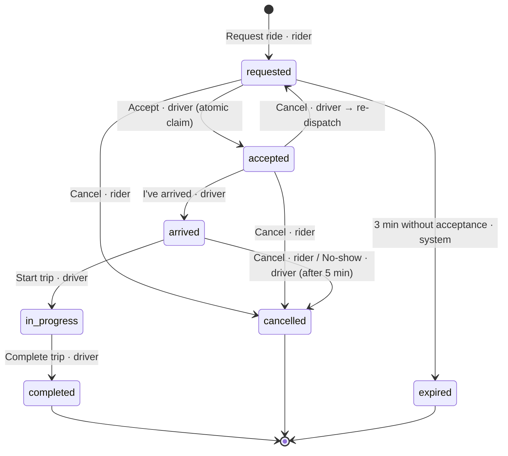
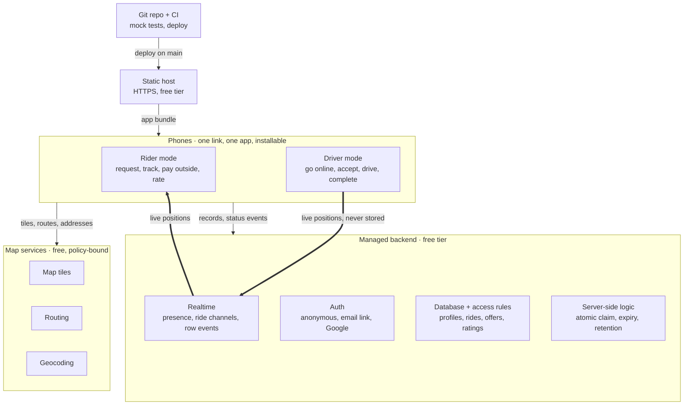

# Siosia — Ride-Hailing Web App Specification

**Created**: 2026-10-09 · **Author**: Roman · **Status**: Draft v0.1 · **Reference**: Rubber (`specs/001-rubber/`)

Siosia is a mobile-first web app, opened from one HTTPS link, in which any user can ride or drive. Riders request a car to a real pickup point and track it live; drivers go online, accept requests and run the trip. This document is the v1 Product & Technical Specification: what the app must do, how the two modes behave, the ride lifecycle, the data, and the hard constraint that the whole system runs at zero cost on free hosting tiers. Rubber is the proven reference — same class of app, same free-tier architecture; Siosia generalises it to many drivers and a neutral brand.

## 1. Scope

Siosia v1 delivers the complete ride loop — request, match, pickup, trip, completion — for a bounded pilot group, with real maps and real GPS but no real payments. Status: Draft v0.1 for review; the stack named in section 10 is a planning input, not a requirement.

**Goal.** One web app, one shareable HTTPS link, two modes. A user opens the link on a phone, picks *Ride* or *Drive*, and is in the loop within a minute. No app store, no server to run, no monthly bill.

**Who uses it**

| Role | Wants | Gets in v1 |
| --- | --- | --- |
| Rider | A car from A to B now, at a known price | Upfront fare and ETA, live car tracking, cancel, receipt, rating, history |
| Driver | To be found when available and to run one trip at a time | Online/offline switch, request cards with pickup distance and fare, accept, navigate hand-off, status buttons, earnings, history |
| Operator (whoever deploys it) | Zero running cost and nothing to maintain | Static front-end + managed backend on free tiers, a setup guide completable in 45 minutes, a demo mode that runs with no backend at all |

**Scale ceiling (drives every budget in section 10).** One service area (one city), ≤ 50 registered users, ≤ 10 drivers online at once, ≤ 5 concurrent active rides, ≤ 300 rides per month. A deployment that needs more moves to a paid tier; the spec does not design for it.

**In scope for v1**

- Both modes in one app, switchable from the home screen (section 3)
- Rider request with pickup from GPS, a dropped pin or an address search, and dropoff by pin or address
- Upfront fare estimate from a real road route, fixed at request time
- Dispatch to every online driver in range; the first to accept wins (section 6)
- Live position of the driver for the rider, and of the rider for the driver, during the active ride
- Ride lifecycle with cancellation rules on both sides (section 5)
- Driver profile with vehicle details shown to the rider after acceptance
- Receipt, two-way rating, ride history, driver earnings
- Installable PWA, mobile-first, English and Polish UI
- Privacy guarantees: location shared only while needed, no coordinate trails stored
- Demo mode (in-browser mock backend) for development, tests and showing the app without a backend
- Deployment on free tiers with CI and a non-expert setup guide

**Out of scope for v1** (recorded so nobody adds them by accident)

- Real payments, cancellation fees, surge pricing — the fare is settled outside the app and only recorded
- Background tracking with the screen locked; turn-by-turn navigation inside the app
- Scheduled rides, shared/pooled rides, vehicle classes, multi-stop trips
- Driver document checks, identity verification, phone numbers, in-app chat or calls
- Closed-tab push notifications, native app wrappers, admin back-office UI

## 2. Rubber as the reference

Rubber (`specs/001-rubber/`, built spec-first with Spec Kit) proves that this class of app runs on free tiers with no custom server; Siosia keeps that architecture and its privacy model, and changes the product scope. What carries over and what changes:

| Topic | Rubber (reference) | Siosia v1 |
| --- | --- | --- |
| Audience | 2–10 friends, one room code, playful toy | Pilot group ≤ 50 users in one city, neutral brand |
| Drivers | One active driver at a time | Up to 10 online at once; request offered to all in range, first accept wins |
| Identity | Nickname + room code, driver PIN, anonymous session | Anonymous session + nickname by default; optional sign-in to keep history across devices; driver profile with vehicle |
| Modes | Landing “Ride or drive?” | Same entry; a user may hold both roles and switches on the home screen, never both at once |
| Pickup / dropoff | GPS or tapped pin | GPS, pin or address search (geocoder with 1 req/s cap and pin fallback) |
| Pricing | Play money: 2 + 1/km, min 3, rush ×1.5, tips | Configurable tariff in a real currency (base + per km + per min, minimum), upfront and fixed at request; no payment processing |
| Live positions | Ephemeral broadcast, never stored | Same — kept as a hard rule (FR-040…FR-044) |
| Rider live position | On by default, switch off | Same |
| Teardown | Presence auto-leave on disconnect | Same, plus server-side expiry of stale requests |
| Ratings | Emoji rating, rider → driver | 1–5 stars both ways, optional short comment |
| History | Last 10 rides per room | Per user, last 50 rides; driver earnings per day and month |
| Navigation | Route line + “open in Google Maps” | Same, plus Apple Maps on iOS |
| Demo mode | In-browser mock backend + robot driver | Same, required (FR-070) |
| Hosting | Static host + Supabase free tier | Same class of architecture; the plan may pick any provider that meets section 10 |
| Visual identity | Duck-yellow on asphalt, duck markers | Neutral: car marker rotating to heading, pin for pickup; theme left to the plan |

Documents worth reading before planning: Rubber’s `research.md` (why live data goes over broadcast and presence, why the PIN is checked server-side), `data-model.md` (RLS gating by membership) and `TESTING.md` (three-window local test launcher).

## 3. Modes and screens

One user, one app, one active mode at a time: *Rider* or *Driver*, chosen on the home screen and remembered for the next launch.

**Entering a mode**

1. First launch: the app creates an anonymous session and asks for a nickname (2–20 characters). Nothing else is required.
2. Home screen shows two cards, *Ride* and *Drive*. A link may preselect one (`?mode=ride` or `?mode=drive`).
3. First entry into *Drive* asks for the vehicle: make, model, colour, plate, seats (1–6). The profile is editable later and is shown to riders only after acceptance.
4. The chosen mode opens full-screen; a *Switch mode* action lives in the profile menu.

**Switching rules**

- A driver may switch only when offline and with no active trip; the app offers *Go offline* first.
- A rider may switch only with no active request or ride; the app offers *Cancel request* first (cancellation rules in section 5).
- Mode is per device session. The same account can be a driver on one phone and a rider on another; the backend rejects a request from a user who is currently online as a driver.
- Switching never loses history, earnings or the vehicle profile.

**Screen list** (names used by the requirements and tests)

| Id | Screen | Mode | Shows / lets the user do |
| --- | --- | --- | --- |
| S1 | Home | both | Ride or Drive, nickname, language (EN/PL), optional sign-in |
| S2 | Profile | both | Nickname, sign-in state, language, vehicle (drivers), switch mode, privacy notice |
| S3 | Permission explainers | both | Why location is needed; what to do when it is denied or inaccurate; keep-screen-on notice for drivers |
| S4 | Sharing indicator | both | Persistent banner whenever this device is sending its position, with one-tap stop |
| R1 | Rider home | rider | Full-screen map; pickup (GPS, pin, address); dropoff (pin, address); nearby available cars; fare and ETA estimate; *Request ride* |
| R2 | Searching | rider | “Finding a driver…” with elapsed time, number of drivers notified, *Cancel* |
| R3 | Active ride | rider | Driver name, rating, vehicle and plate; live car marker, route, ETA; status line; *Cancel* until the driver has arrived; navigate hand-off to the pickup point |
| R4 | Receipt | rider | Fare, distance, duration, pickup/dropoff; *Mark as paid* confirmation; 1–5 star rating + comment |
| R5 | Ride history | rider | Last 50 rides: date, from/to, fare, status |
| D1 | Driver dashboard | driver | Online/offline switch, today’s earnings and ride count, map with own position, incoming offers |
| D2 | Offer card | driver | Rider nickname and rating, distance and ETA to pickup, trip distance, fare, 20-second countdown, *Accept* / *Decline* |
| D3 | Active trip | driver | Route to pickup then to dropoff, rider live pin, *I’ve arrived* → *Start trip* → *Complete trip*, *Navigate* hand-off, *Cancel* with reason |
| D4 | Trip summary | driver | Fare, *Collected* confirmation, 1–5 star rating of the rider |
| D5 | Earnings & history | driver | Today / this month totals, last 50 trips |
| D6 | Vehicle profile | driver | Make, model, colour, plate, seats |

## 4. User stories and acceptance scenarios

Eight stories, each independently buildable and testable. P1 stories together are the MVP; P2 and P3 add robustness and the after-ride experience.

### US1 — Rider requests and tracks a ride (P1)

A rider opens the link, picks *Ride*, sets pickup (own GPS position by default) and dropoff, sees distance, duration and a fixed fare, and requests. When a driver accepts, the rider sees the driver and vehicle, the car moving along a real road route, and an ETA that keeps updating until the trip is complete.

**Why P1**: this is the product. **Independent test**: two phones outdoors; a rider requests, a moving driver accepts, the rider sees the car marker and ETA refresh at least every 5 s through pickup, trip and completion.

1. **Given** pickup and dropoff are set, **When** the rider taps *Request ride*, **Then** R2 shows “Finding a driver…” and the fare shown on R1 is stored on the ride and never changes.
2. **Given** a pending request, **When** a driver accepts, **Then** within 1 s the rider sees R3 with the driver’s nickname, rating, vehicle and plate, and the car marker on the map.
3. **Given** an accepted ride, **When** the driver moves, **Then** the marker and ETA update at least every 5 s and the marker rotates to the heading.
4. **Given** the driver advances the status, **When** each change happens, **Then** the rider’s status line reflects it within 1 s.
5. **Given** a completed trip, **When** R4 opens, **Then** it shows the fixed fare, the distance and duration actually driven, and all position sharing has stopped.

### US2 — Driver goes online, accepts and runs a trip (P1)

A driver picks *Drive*, completes the vehicle profile once, goes online (location permission + keep-screen-on), receives offer cards, accepts one, drives to the pickup with the rider’s live pin visible, and advances *Arrived* → *Start* → *Complete*. Earnings update.

**Why P1**: the other half of the loop. **Independent test**: a driver goes online on one phone, receives a request generated from another device, accepts and completes the full status sequence while positions stream.

1. **Given** the driver taps *Go online*, **When** location permission is granted, **Then** S4 appears, the screen wake lock engages and the position streams at most every 3 s or 25 m.
2. **Given** an offer arrives, **When** D2 is shown, **Then** it plays a chime, vibrates, and shows the distance and ETA from the driver’s current position to the pickup plus the fare, with a 20-second countdown.
3. **Given** the driver accepts, **When** D3 opens, **Then** the map shows the route to the pickup and the rider’s live pin, and *Navigate* opens the pickup in the phone’s maps app.
4. **Given** the driver taps *Start trip*, **When** the trip begins, **Then** the route switches to the dropoff and the rider pin is replaced by the dropoff pin.
5. **Given** *Complete trip*, **When** D4 opens, **Then** today’s earnings on D1 include this fare and the driver is back to online with no active trip.

### US3 — Dispatch among several drivers (P1)

A request is offered to every online, idle driver within range at the same time. The first to accept wins; the others see the offer disappear. Declines and timeouts are recorded; a request nobody accepts within 3 minutes expires.

**Why P1**: with more than one driver, the MVP is not usable without a deterministic rule. **Independent test**: three driver sessions online (two can be the robot driver), one request; exactly one driver ends up assigned, the others’ cards vanish within 1 s.

1. **Given** three idle drivers within 8 km, **When** a rider requests, **Then** all three see D2 within 1 s, sorted by their own distance to the pickup.
2. **Given** two drivers tap *Accept* within the same second, **When** the backend processes both, **Then** exactly one succeeds; the other sees “Taken by another driver”.
3. **Given** a driver declines or lets the 20 s countdown lapse, **When** that happens, **Then** the card is removed for that driver only and the request stays open for the rest.
4. **Given** no driver accepts within 3 minutes, **When** the time passes, **Then** the ride becomes *expired*, the rider sees it on R2 with a *Try again* action, and all cards disappear.
5. **Given** a driver with an active trip, **When** a new request arrives, **Then** that driver receives no offer.

### US4 — Privacy and safe teardown (P1)

A device sends its position only while it is a driver online or a rider in an active request/ride. S4 is always visible while sending, with one-tap stop. Going offline, cancelling, completing, or losing the tab ends the stream. No coordinate trail is stored; history keeps endpoints and totals.

**Why P1**: real GPS among real people is the main risk; it is an acceptance requirement. **Independent test**: for each exit path (offline, cancel, complete, tab killed, airplane mode) confirm the other side’s marker disappears within 10 s and the ride record holds only endpoints.

1. **Given** an active ride, **When** the driver goes offline or the trip completes, **Then** both streams stop immediately and the other side’s live marker is removed.
2. **Given** a driver online, **When** the browser tab is killed, **Then** the driver is offline for everyone within 10 s and open offers to that driver are withdrawn.
3. **Given** a rider in an active ride, **When** they tap *Stop sharing* on S4, **Then** the driver navigates to the fixed pickup pin and sees “Rider stopped sharing”.
4. **Given** any completed, cancelled or expired ride, **When** its record is inspected, **Then** it contains pickup, dropoff, distance, duration, fare, timestamps and nothing else about location.

### US5 — Nearby cars and address search (P2)

Before requesting, the rider sees available cars nearby as coarse markers, and can type an address for pickup or dropoff instead of placing a pin.

**Why P2**: this is what makes it feel like a ride-hailing app, but the loop works without it. **Independent test**: with two drivers online, R1 shows two car markers refreshing every 30 s; typing an address and choosing a result moves the pin.

1. **Given** idle drivers online within 8 km, **When** R1 is open, **Then** their positions appear as car markers refreshed every 30 s or 200 m, with no nickname or plate.
2. **Given** the rider types at least 4 characters and taps *Search*, **When** results return, **Then** up to 5 suggestions are shown; choosing one places the pin and labels the field.
3. **Given** the geocoder is unreachable, **When** the rider searches, **Then** a message explains it and the pin method still works.

### US6 — Graceful degradation (P2)

Denied or poor GPS falls back to manual pins with an accuracy circle and an explanation. An unreachable router falls back to straight-line distance with a rough ETA and the fare is marked *estimate*. A paused or unreachable backend is reported plainly with a retry, never a blank screen.

**Why P2**: real-world reliability; the happy path can be shown without it. **Independent test**: deny location, block the routing host and stop the backend in turn; every flow still reaches a usable state with a message.

1. **Given** location permission denied, **When** the rider opens R1, **Then** S3 explains why and the rider can place and drag pins.
2. **Given** the routing service fails, **When** an estimate is requested, **Then** straight-line distance × 1.3 and a rough ETA are shown within 2 s, labelled as an estimate.
3. **Given** the backend is unreachable, **When** the app loads, **Then** it shows “Service unavailable — retry” and, in demo deployments, offers demo mode.

### US7 — Receipts, ratings, history and earnings (P3)

After a trip, the rider confirms payment outside the app and rates the driver; the driver confirms collection and rates the rider. Both see history; the driver sees earnings per day and month.

**Why P3**: rounds out the experience; the loop is complete without it. **Independent test**: complete two rides and cancel one; both histories and the driver’s totals are correct.

1. **Given** a completed trip, **When** R4 opens, **Then** the rider can mark it paid and give 1–5 stars with an optional comment of up to 140 characters.
2. **Given** a completed trip, **When** D4 opens, **Then** the driver can mark the fare collected and rate the rider.
3. **Given** several rides, **When** R5 or D5 opens, **Then** the last 50 are listed newest first with status, and driver totals exclude cancelled and expired rides.
4. **Given** a rated user, **When** their rating is shown, **Then** it is the average of their last 20 ratings, or “New” with fewer than 3.

### US8 — Keep the account across devices (P3)

A user may link an email (magic link) or a Google account to the anonymous session so history, ratings and the vehicle profile follow them to another phone.

**Why P3**: convenience; the anonymous session is enough for a pilot. **Independent test**: link an account, open the link on a second phone, sign in, see the same history.

1. **Given** an anonymous user, **When** they sign in from S2, **Then** the existing history and profile are kept under the linked account.
2. **Given** a signed-in user, **When** they sign in on another device, **Then** the same history and profile appear within 5 s.

## 5. Ride lifecycle

A ride has seven statuses; five are on the happy path and two are terminal failures. Every transition is validated on the server, so a stale client can never move a ride backwards or skip a step.

The happy path runs top to bottom and is driven by the driver; the rider can leave it until the driver has arrived, and a driver who cancels sends the ride back to *requested* for another driver.

| From | To | Trigger | Who | Guard and side effects |
| --- | --- | --- | --- | --- |
| — | requested | *Request ride* | rider | Rider has no active ride and is not online as a driver. Fare is computed and frozen. Offers are created for idle drivers within 8 km. Expiry timer: 3 min. |
| requested | accepted | *Accept* | driver | Atomic claim: succeeds only while status is still *requested* and the driver is idle. All other offers are withdrawn. |
| requested | expired | 3 min without acceptance | system | Offers withdrawn. Rider sees *Try again*. |
| requested | cancelled | *Cancel* | rider | Offers withdrawn. Counted in the rider’s cancellation stats. |
| accepted | arrived | *I’ve arrived* | driver | Warn if farther than 300 m from the pickup; still allowed. Rider is notified. Wait timer starts. |
| accepted | requested | *Cancel* with reason | driver | Re-dispatch: new offers to idle drivers except this one; expiry timer restarts; rider sees “Finding another driver”. The driver’s cancellation is counted. |
| accepted | cancelled | *Cancel* | rider | Driver notified; driver back to idle. Counted. |
| arrived | in\_progress | *Start trip* | driver | Rider position sharing stops; route switches to dropoff. |
| arrived | cancelled | *Cancel* | rider | Counted as late cancellation (no fee in v1). |
| arrived | cancelled | *No-show* | driver | Allowed only after 5 min of waiting at the pickup. |
| in\_progress | completed | *Complete trip* | driver | Actual distance and duration recorded; earnings updated; all sharing stops; receipt and summary opened on both sides. |
| completed | completed | *Mark paid*, *Collected*, rating | both | Allowed within 24 h of completion; status unchanged. |

Terminal statuses are *completed*, *cancelled* and *expired*. A cancelled ride records who cancelled (rider, driver or system) and the reason, if given. Timers (3 min expiry, 20 s offer countdown, 5 min no-show wait) are configurable per deployment but have these defaults.

## 6. Matching and dispatch

Broadcast dispatch: one request is offered to every eligible driver at once and the first acceptance wins. It needs no server-side scheduler, survives drivers dropping out, and is deterministic to test.

**Eligible driver** = online, no active trip, last position newer than 60 s, straight-line distance to the pickup ≤ 8 km (configurable), not the rider, and not a driver who cancelled this ride earlier.

**Offer rules**

1. On *Request ride* the backend creates one *offer* per eligible driver, status *offered*, with the same 20 s countdown shown on each D2. If no driver is eligible, the rider is told at once (“No drivers nearby”) and the request still stays open for 3 min in case a driver comes online.
2. Offer cards are sorted on each phone by that driver’s own distance to the pickup. Riders see on R2 how many drivers were notified, not who.
3. *Accept* is an atomic server-side claim: it sets the ride’s driver and status in one operation that fails if the ride is no longer *requested*. The loser sees “Taken by another driver”; all other offers become *withdrawn*.
4. *Decline* or a lapsed countdown marks only that driver’s offer *declined* or *timed\_out*. The request stays open; a driver who becomes eligible later (comes online, finishes a trip) receives a fresh offer while the request is open.
5. A driver holds at most one *offered* card at a time; further requests queue and are shown after a decision, oldest first, and are dropped if their 3 min expiry passes meanwhile.
6. After a driver cancels an accepted ride, the ride returns to *requested* and steps 1–5 run again without that driver.
7. The 3 min expiry is enforced server-side (a scheduled job or an expiry check on read), not only by the rider’s device, so a rider who closes the tab does not leave a ghost request.

**Fare estimate shown on the offer** is the frozen fare from the ride, plus the driver’s own distance and ETA to the pickup computed on the driver’s device from the latest route or straight-line fallback.

**Not in v1**: nearest-first sequential offering, driver scoring, destination filters, auto-accept. They can be added behind the same *offer* entity.

## 7. Functional requirements

Numbered by group so a plan or test can cite them; gaps in numbering are intentional room for additions. Every requirement is testable without knowing the stack.

**Identity and access**

- **FR-001**: The system MUST serve both modes from one HTTPS URL, with S1 offering *Ride* and *Drive*, and MUST honour `?mode=ride|drive` preselection.
- **FR-002**: The system MUST create an anonymous session on first launch and require only a nickname (2–20 characters, no personal data) to use either mode.
- **FR-003**: The system MUST let a user link an email (magic link) or Google account to the anonymous session and MUST keep the existing history, ratings and vehicle profile.
- **FR-004**: The system MUST require a vehicle profile (make, model, colour, plate, seats 1–6) before a driver can go online, editable on D6.
- **FR-005**: The system MUST refuse a ride request from a user who is currently online as a driver, and MUST refuse *Go online* for a user with an active request or ride.
- **FR-006**: The system MUST enforce every read and write on the server: a user may read only rides they take part in, offers addressed to them, their own profile and the public driver fields (nickname, rating, vehicle) of a driver assigned to them.
- **FR-007**: A deployment MUST be joinable only by people holding an invite code set by the operator; the code is entered once per device and MUST be verified server-side.

**Rider mode**

- **FR-010**: R1 MUST show a real street map centred on the rider’s position, with pickup defaulting to the GPS position and an accuracy circle.
- **FR-011**: The rider MUST be able to set pickup and dropoff by dragging a pin, by long-pressing the map, or by address search (US5); the chosen label MUST be shown in the field.
- **FR-012**: Before requesting, R1 MUST show route distance (km, one decimal), duration (min) and the fare, refreshed when either point changes.
- **FR-013**: *Request ride* MUST be disabled until both points are set and the pickup is within the service area; the fare shown at that moment MUST be frozen on the ride.
- **FR-014**: R2 MUST show elapsed search time, the number of drivers notified, and *Cancel*; it MUST show *Try again* when the request expires.
- **FR-015**: R3 MUST show the assigned driver’s nickname, rating, vehicle make/model/colour and plate, the live car marker rotated to heading, the route, the ETA and the status line.
- **FR-016**: The rider MUST be able to cancel while the ride is *requested*, *accepted* or *arrived*, with a confirmation step once a driver is assigned.
- **FR-017**: R4 MUST show fare, distance, duration, pickup and dropoff, a *Mark as paid* control and a 1–5 star rating with an optional comment of up to 140 characters.
- **FR-018**: R1 MUST show idle drivers within 8 km as anonymous car markers, refreshed at most every 30 s or 200 m (US5).

**Driver mode**

- **FR-020**: D1 MUST provide an online/offline switch; going online MUST request location permission, engage a screen wake lock and show S4.
- **FR-021**: While online and idle, the driver’s device MUST send its position at most every 3 s or 25 m of movement to the matching service, and at most every 30 s or 200 m to the nearby-cars view.
- **FR-022**: D2 MUST show rider nickname and rating, distance and ETA from the driver to the pickup, trip distance, fare, a 20 s countdown, *Accept* and *Decline*, and MUST announce a new offer with a chime and vibration where the device allows it.
- **FR-023**: D3 MUST show the route to the pickup, then to the dropoff after *Start trip*, with the rider’s live pin while sharing is on and the fixed pickup pin otherwise.
- **FR-024**: D3 MUST provide *I’ve arrived*, *Start trip* and *Complete trip* in order, plus *Navigate* (opens the current target in the phone’s maps app) and *Cancel* with a reason list (rider no-show, wrong pickup, vehicle problem, other).
- **FR-025**: *No-show* MUST be available only 5 min after *I’ve arrived*.
- **FR-026**: D4 MUST show the fare, a *Collected* control and a 1–5 star rating of the rider.
- **FR-027**: D1 MUST show today’s completed rides and earnings; D5 MUST show today and this month plus the last 50 trips.
- **FR-028**: Going offline MUST be blocked while a trip is *accepted*, *arrived* or *in\_progress*; the driver MUST cancel or complete first.

**Live tracking and maps**

- **FR-030**: The system MUST obtain positions with the browser geolocation API in high-accuracy mode and MUST show an accuracy circle whenever accuracy is worse than 50 m.
- **FR-031**: The system MUST compute road distance, duration and the route line from a routing service for every estimate and active trip, and MUST redraw the route when the car deviates by more than 100 m.
- **FR-032**: When routing is unavailable within 2 s, the system MUST fall back to straight-line distance × 1.3 and an ETA at 30 km/h, labelled as an estimate.
- **FR-033**: Map tiles, routing and geocoding MUST show the required attribution and MUST respect each provider’s usage policy (section 10); geocoding MUST be triggered by an explicit action, never per keystroke, and MUST be capped at 1 request per second per device.
- **FR-034**: The live marker of the other party MUST update at least every 5 s while moving and MUST disappear within 10 s of the other side stopping.
- **FR-035**: The system MUST compute distance and duration actually driven from the positions of the trip segment and store only the totals.

**Privacy and teardown**

- **FR-040**: A device MUST send its position only while it is a driver online or a rider in a *requested*, *accepted* or *arrived* ride (rider sharing may be turned off; it stops at *in\_progress*).
- **FR-041**: S4 MUST be visible on every screen while the device is sending, with a one-tap stop that also ends the activity (goes offline or stops rider sharing).
- **FR-042**: Going offline, cancelling, completing, expiry, a killed tab or a lost connection MUST end the stream within 10 s with no user action.
- **FR-043**: Live coordinates MUST never be written to durable storage; a ride record MUST hold only pickup, dropoff, totals, timestamps, fare, statuses and ratings.
- **FR-044**: Riders MUST see a driver’s plate and vehicle only after assignment; drivers MUST see a rider’s position only during an active ride; nobody else sees either.

**Pricing**

- **FR-050**: Fare = base + rate × km + rate × min, rounded to 0.50, never below the minimum fare; the four values and the currency are deployment configuration with defaults 5.00 + 2.50/km + 0.50/min, minimum 10.00, PLN.
- **FR-051**: The fare MUST be computed from the estimated route at request time and MUST NOT change afterwards, including on re-dispatch.
- **FR-052**: The receipt MUST show the frozen fare next to the actual distance and duration so a difference is visible.
- **FR-053**: The system MUST NOT process payments; *Mark as paid* and *Collected* are flags on the ride.

**Ratings, history, earnings**

- **FR-060**: Both parties MAY rate once per completed ride within 24 h; a rating cannot be edited afterwards.
- **FR-061**: A user’s displayed rating is the mean of their last 20 ratings, shown as “New” with fewer than 3.
- **FR-062**: History MUST list the last 50 rides per user, newest first, with date, from, to, fare and status.
- **FR-063**: Earnings MUST sum fares of *completed* rides only, in the deployment’s timezone.
- **FR-064**: Cancellation counts per user MUST be stored and shown to the user on S2 (not to others) in v1.

**Platform, installability, demo**

- **FR-070**: The app MUST run in demo mode with an in-browser mock backend and a robot driver when no backend is configured or when `?backend=mock` is set; the full ride loop MUST work across two tabs in this mode.
- **FR-071**: The app MUST be an installable PWA (manifest, icons, standalone display) with an offline shell that explains connectivity is required.
- **FR-072**: Layouts MUST be mobile-first, usable from 360 px width, with touch targets ≥ 44 px and the map filling the screen behind sheets.
- **FR-073**: The UI MUST be available in English and Polish, selectable on S1/S2 and defaulting to the browser language.
- **FR-074**: The app MUST respect reduced-motion preferences and MUST meet WCAG 2.1 AA contrast.
- **FR-075**: The app MUST show S3 explainers for denied location, poor accuracy, wake-lock unavailability and a paused or unreachable backend, each with the next action.
- **FR-076**: Configuration (backend URL and public key, tariff, timers, service area, invite code hash, map and routing endpoints) MUST be injected at build time or read from one config file; no secret MUST ever ship to the browser.

## 8. Non-functional requirements

The numbers below are the acceptance thresholds; each is measurable on real phones or in the mock-backend test run.

| Id | Area | Requirement |
| --- | --- | --- |
| NFR-01 | Latency | Status changes and acceptance reach the other party in ≤ 1 s (p95) on a 4G connection; live marker updates in ≤ 2 s end to end. |
| NFR-02 | Load time | First meaningful screen in ≤ 3 s on a mid-range Android phone over 4G; initial JavaScript ≤ 300 kB compressed, map tiles excluded. |
| NFR-03 | Capacity | 10 drivers online and 5 active rides at once with no degradation of NFR-01, inside the free-tier budget of section 10. |
| NFR-04 | Availability | No single external dependency may dead-end a flow: tiles, routing, geocoding and the backend each have a defined fallback or message (US6). |
| NFR-05 | Data integrity | Exactly one driver per ride; no illegal status transition; fare immutable after request — all enforced server-side, not only in the client. |
| NFR-06 | Privacy | No coordinate trail stored (FR-043); nickname is the only personal field; linked email is held by the auth provider, not copied into app tables. |
| NFR-07 | Security | All traffic over HTTPS; row-level access rules for every table; atomic claims for *Accept*; invite code and any PIN verified server-side; no secret in the browser bundle; anonymous sign-up rate-limited or behind a CAPTCHA. |
| NFR-08 | Battery | Position sampling throttled as in FR-021; wake lock only while online; no background work while offline. |
| NFR-09 | Browser support | Current Android Chrome and iOS Safari (last two major versions); the app warns on unsupported browsers instead of failing silently. |
| NFR-10 | Accessibility | WCAG 2.1 AA contrast, 44 px targets, visible focus, screen-reader labels on all controls, reduced-motion respected. |
| NFR-11 | Localisation | English and Polish, all user-facing strings externalised; metric units; currency from configuration. |
| NFR-12 | Observability | Client errors and backend errors visible to the operator without paid tooling (console in dev, the backend’s own logs in production); no third-party analytics. |
| NFR-13 | Operability | Fresh deployment from an empty account to a working link in ≤ 45 min by a non-expert following the setup guide; zero recurring cost at the stated scale. |
| NFR-14 | Testability | Unit tests for fare, state machine, throttling and eligibility; an end-to-end test of the full loop on the mock backend runs in CI without any cloud credentials. |

## 9. Data model

Two layers, as in Rubber: durable records in the database and ephemeral messages on realtime channels. Live positions exist only in the ephemeral layer, so there is nothing to purge after a ride.

**Durable entities**

| Entity | Key attributes | Rules |
| --- | --- | --- |
| Profile | user id, nickname, language, created at, cancellation counts (as rider, as driver), ratings summary (mean, count) | One per user; nickname is the only personal field. Linked email lives in the auth provider. |
| Vehicle | user id, make, model, colour, plate, seats | One per driver; required before going online; plate visible to the assigned rider only. |
| Deployment config | tariff (base, per km, per min, minimum, currency), timers (offer 20 s, expiry 3 min, no-show 5 min), service-area centre and radius, dispatch radius 8 km, invite-code hash | One row; readable by clients except the hash; editable only by the operator. |
| Ride | id, rider id, driver id (nullable), status, pickup (lat, lng, label), dropoff (lat, lng, label), estimated distance km, estimated duration min, fare, currency, actual distance km, actual duration min, requested/accepted/arrived/started/ended at, cancelled by, cancel reason, paid flag, collected flag, re-dispatch count | Status transitions as in section 5, enforced server-side. No position columns. |
| Offer | id, ride id, driver id, status (offered, declined, timed\_out, withdrawn, won), offered at, decided at, driver distance to pickup km at offer time | One per (ride, driver) per dispatch round; the *won* offer is the one whose atomic claim succeeded. |
| Rating | ride id, from user, to user, stars 1–5, comment ≤ 140, created at | At most one per direction per ride; immutable. |
| Device membership | user id, device id, invite accepted at | Proves the invite code was entered on this device (FR-007). |

**Derived, not stored**: driver earnings (sum over completed rides), history lists, displayed ratings (mean of last 20) — computed by query or view.

**Ephemeral messages** (realtime channels; never persisted)

| Channel | Message | Sender → receivers | Cadence |
| --- | --- | --- | --- |
| Driver presence | online, idle or busy, coarse position (rounded to \~100 m), heading | driver → riders on R1, matching logic | On change and every 30 s or 200 m; auto-removed on disconnect |
| Ride channel (one per active ride) | `driver_pos` (lat, lng, heading, accuracy, time) | driver → the ride’s rider | Every 3 s or 25 m while *accepted*, *arrived*, *in\_progress* |
| Ride channel | `rider_pos` (lat, lng, accuracy, time) | rider → the ride’s driver | Every 3 s or 25 m while *requested*–*arrived* and sharing is on |
| Ride channel | `sharing_stop` | either → the other | Once, on stop, offline, cancel, complete |
| Ride and Offer tables | row change events | database → the parties with read access | On every status or offer change |

**Retention**: rides, offers and ratings are kept for 12 months then deleted by a scheduled job; a user may delete their profile, which anonymises their rides (nickname replaced by “Deleted user”) and removes their vehicle.

## 10. Deployment on free hosting

The whole system must run at zero recurring cost: a static front-end on a free static host, a managed backend on a free tier, and community map services used within their policies. There is no custom always-on server, because free server tiers sleep or expire and would break the realtime loop.

*Thick arrows carry live positions: they pass through Realtime and are never stored. All other arrows carry the app bundle, records and status events.*

Phones load the app once from the static host and then talk only to the managed backend and the map services; live positions cross the backend’s realtime layer and never reach the database.

**Deployment requirements**

- **D-01 Static host.** The front-end is a static bundle served over HTTPS from any of: GitHub Pages (public repository), Cloudflare Pages, Netlify Free, Vercel Hobby. The build MUST be host-agnostic (relative asset paths or a configurable base path) so the operator can switch host by changing one setting. Vercel Hobby and GitHub Pages exclude commercial use; a pilot qualifies, a paid service does not.
- **D-02 Managed backend.** One free-tier backend provides authentication (anonymous + email/Google), a database with row-level access rules, push-based realtime (presence and broadcast or equivalent), and a way to run the atomic claim and the 3-minute expiry server-side (database function, trigger, scheduled job or free serverless function). Reference choice: Supabase Free, as in Rubber. Acceptable alternative: Firebase Spark with Realtime Database for positions and Firestore for records. The plan MUST put all backend access behind one interface so the mock backend (FR-070) and the real one are interchangeable.
- **D-03 Map services.** Tiles from an OpenStreetMap-compatible source with visible attribution, a valid Referer and no prefetching; routing from the OSRM demo server or another free router; geocoding from Nominatim or another free geocoder. All three endpoints MUST be configuration, so a self-hosted or alternative provider can be swapped in without code changes. Client behaviour MUST stay within the policies: ≤ 1 routing request per second per device and ≤ 1 route refresh per 10 s during a trip; geocoding only on explicit search, ≤ 1 request per second, results cached per session; no tile bulk download or offline tile storage.
- **D-04 Pause handling.** The free backend pauses after 1 week without activity. The app MUST detect an unreachable backend within 5 s and show S3 with the operator’s contact; the setup guide MUST explain how to restore the project, and MAY describe a weekly keep-alive ping from the CI scheduler.
- **D-05 CI/CD.** A public Git repository with a free CI runner (GitHub Actions) MUST run lint, type check, unit tests and the mock-backend end-to-end test on every push, and deploy to the static host on the main branch. The e2e job MUST need no cloud credentials.
- **D-06 Configuration and secrets.** Backend URL and publishable key, tariff, timers, service area, map endpoints and the invite-code hash are build-time variables or one JSON config; only publishable keys reach the browser. The repository MUST ship an `.env.example` and a `config.example.json`.
- **D-07 Setup guide.** A step-by-step guide for a non-expert: create the backend project, run the schema, enable anonymous sign-in, set the invite code, build, deploy, open on a phone, run the two-phone test. Target ≤ 45 min; each step names where to click and what to copy.
- **D-08 Budget.** At the scale ceiling of section 1 the system MUST stay inside the free-tier limits below with at least 25 % headroom; the cadences in FR-021 and FR-018 are the levers if it does not.

**Free-tier budget** (limits as published on 9 Oct 2026; estimate = the scale ceiling: 10 drivers online 6 h/day, 300 rides/month, 50 users)

| Resource | Free limit | v1 estimate at ceiling | Headroom | Source |
| --- | --- | --- | --- | --- |
| Supabase realtime messages / month | 2 000 000 | \~1.2 M (presence fan-out \~0.9 M, ride positions \~0.3 M) | 40 % | [Supabase pricing](https://supabase.com/pricing) |
| Supabase concurrent realtime connections | 200 | ≤ 100 (50 users × up to 2 channels) | 50 % | [Supabase pricing](https://supabase.com/pricing) |
| Supabase database size | 500 MB | < 20 MB (300 rides and \~3 000 offers per month, 12-month retention) | > 95 % | [Supabase pricing](https://supabase.com/pricing) |
| Supabase egress / month | 5 GB | < 0.5 GB (records only; tiles never pass through the backend) | 90 % | [Supabase pricing](https://supabase.com/pricing) |
| Supabase monthly active users | 50 000 | 50 | \~100 % | [Supabase pricing](https://supabase.com/pricing) |
| Supabase free projects per account | 2 active; paused after 1 week idle | 1 | — | [Supabase pricing](https://supabase.com/pricing) |
| Firebase Spark (alternative): RTDB connections / download | 100 concurrent / 10 GB per month | ≤ 100 / < 1 GB | 0 % on connections at 50 users with 2 each — use 1 connection per client | [Firebase pricing](https://firebase.google.com/pricing) |
| GitHub Pages | 1 GB site, 100 GB bandwidth per month, 10 builds per hour; non-commercial | \~2 MB site, < 1 GB per month | > 95 % | [GitHub Pages limits](https://docs.github.com/en/pages/getting-started-with-github-pages/github-pages-limits) |
| Cloudflare Pages Free | 500 builds per month, 20 000 files, 25 MiB per file; no bandwidth cap listed | \~60 builds, \~100 files | > 85 % | [Cloudflare Pages limits](https://developers.cloudflare.com/pages/platform/limits/) |
| Netlify Free | 300 credits per month (bandwidth at 20 credits per GB), 1 concurrent build; hard stop, no overage charges | < 1 GB bandwidth + \~60 deploys | depends on credit pricing of deploys — verify during planning | [Netlify pricing](https://www.netlify.com/pricing/) |
| Vercel Hobby | 100 GB fast data transfer per month, 100 deployments per day; non-commercial only | < 1 GB, \~2 deploys per day | > 95 % | [Vercel fair use](https://vercel.com/docs/limits/fair-use-guidelines) |
| OSM raster tiles | No numeric cap; attribution, unique Referer, honour cache headers, no prefetch or offline | Interactive viewing only | policy, not quota | [OSM tile usage policy](https://operations.osmfoundation.org/policies/tiles/) |
| OSRM demo router | ≤ 1 request per second; reasonable non-commercial use; no uptime guarantee | ≤ 1 per 10 s per active trip, straight-line fallback | policy, not quota | [OSRM demo server](https://github.com/Project-OSRM/osrm-backend/wiki/Demo-server) |
| Nominatim geocoder | ≤ 1 request per second; no autocomplete; cache results; identify the app | Explicit search only, ≤ 5 results | policy, not quota | [Nominatim usage policy](https://operations.osmfoundation.org/policies/nominatim/) |

The realtime estimate counts each message once when sent and once per receiving client. Presence fan-out dominates: 10 drivers × 120 updates per hour × 6 h × 30 days ≈ 216 000 sent, delivered to up to 3 riders viewing R1. If a deployment runs hotter, lower the idle cadence from 30 s to 60 s before anything else.

## 11. Testing and acceptance

v1 is accepted when the automated suite is green in CI and the two-phone field test passes on real streets. Both are required; neither replaces the other.

| Level | What it covers | Runs where |
| --- | --- | --- |
| Unit | Fare formula and rounding (FR-050); state machine, every legal and illegal transition (section 5); eligibility and offer rules (section 6); position throttling (FR-021); straight-line fallback maths (FR-032); rating mean and “New” rule (FR-061) | CI, every push |
| Component | Each screen in section 3 renders its states (loading, empty, error, active) in EN and PL; S4 appears whenever sharing is on | CI, every push |
| Integration (mock backend) | Full loop rider → request → three driver sessions → one claim wins → arrived → start → complete → receipt and ratings; cancellation on each side; re-dispatch after driver cancel; expiry at 3 min with faked clock | CI, every push, no credentials |
| End-to-end (browser) | Two browser contexts on the mock backend with mocked geolocation driving the P1 stories; a third context as the robot driver | CI, every push |
| Backend rules | Access-rule tests: a user cannot read another’s ride, offers not addressed to them, or a plate before assignment; a second *Accept* fails; an illegal transition is rejected; the invite code is enforced | CI against a throwaway backend project when credentials are present, otherwise on demand |
| Field test | Two phones outdoors (plus one robot driver): the P1 acceptance scenarios of US1–US4, each teardown path, screen lock on the driver phone, airplane mode for 30 s on each side | Before release, recorded as a checklist with device and OS versions |

**Canonical acceptance test (two phones)**

1. Driver phone: open the link, *Drive*, vehicle profile, invite code, *Go online*. S4 visible, wake lock on.
2. Rider phone: open the link, *Ride*, invite code, pickup from GPS, dropoff 2–3 km away by address search. Fare and ETA shown.
3. Rider: *Request ride*. Driver: offer card within 1 s with distance to pickup and countdown; *Accept*.
4. Rider: driver card, vehicle and plate shown; car marker moves and ETA updates while the driver walks or drives 200 m.
5. Driver: *I’ve arrived* → rider status updates within 1 s. *Start trip* → rider pin disappears, route to dropoff shown on both phones.
6. Driver: *Complete trip*. Both phones: receipt and summary; both S4 banners gone; the other phone’s live marker gone within 10 s.
7. Both: rate each other; history shows the ride; driver earnings include the fare.
8. Repeat steps 3–4 and have the driver kill the browser tab: rider sees “Finding another driver” within 10 s.
9. Operator: inspect the ride record in the backend console — endpoints, totals, timestamps, fare, no positions.

**Definition of done for v1**

- [ ] All FR-0xx in section 7 traced to at least one automated test or a field-test step
- [ ] CI green on main: lint, type check, unit, component, integration, e2e
- [ ] Field test passed on one Android and one iOS phone, checklist filed in the repository
- [ ] Setup guide followed by someone who has not seen the code, in ≤ 45 min, on a fresh account
- [ ] Free-tier budget (section 10) re-checked against the backend’s usage page after the field test
- [ ] Demo mode works from the deployed link with `?backend=mock`

## 12. Edge cases

Each case names the expected behaviour so it can become a test.

| Situation | Expected behaviour |
| --- | --- |
| No driver accepts for 3 min | Ride → *expired*; rider sees *Try again*, which creates a new ride with a fresh fare. |
| Two drivers accept in the same second | One claim succeeds; the other gets “Taken by another driver” and stays idle. |
| Driver cancels after accepting | Ride back to *requested*, re-dispatched without that driver, expiry timer restarts, rider told; driver’s cancellation count +1. |
| Rider cancels after the driver has arrived | Ride *cancelled*, counted as late; driver returns to idle and sees a short notice. |
| Rider does not show up | Driver may tap *No-show* 5 min after *I’ve arrived*; ride *cancelled* with reason. |
| Rider walks away from the pickup pin | With sharing on, the driver’s target follows the rider; with sharing off, the fixed pin stays and the rider sees a hint to re-pin. |
| Driver’s screen locks | Positions pause; the driver sees the keep-screen-on notice when returning; the rider’s marker shows “last seen 40 s ago” after 10 s without updates. |
| Driver tab killed or phone offline for > 10 s | Presence drops; offers to that driver are withdrawn; an *accepted* or *arrived* ride is re-dispatched after 60 s without contact; an *in\_progress* ride waits and shows “reconnecting” to the rider. |
| Rider tab killed during *requested* | The server-side expiry still runs; a driver who accepts gets the ride; the rider finds R3 on reopening. |
| Rider tab killed during the trip | The trip continues; on reopening the rider lands on R3 or R4. |
| Location permission denied | S3 explains; manual pins everywhere; a driver cannot go online without location. |
| GPS accuracy worse than 100 m | Accuracy circle shown; the rider is asked to confirm or move the pickup pin. |
| Routing service unreachable | Straight-line estimate labelled as such; route line omitted; the fare is still frozen on that estimate. |
| Geocoder unreachable or rate-limited | Message plus pin fallback; search retried only on the next explicit tap. |
| Backend paused (free tier) or unreachable | S3 “Service unavailable” with retry and contact; demo mode offered where enabled. |
| Pickup outside the service area | *Request ride* disabled with the reason shown. |
| Same person tries to be driver and rider | Blocked by FR-005 on both sides with a message naming the other active role. |
| More requests than the driver can review | One card at a time, oldest first, each with its own countdown; expired ones vanish. |
| Clock skew between devices | Countdowns and expiry are computed from server timestamps, not device clocks. |
| Device language neither EN nor PL | English with a language switch on S1. |

## 13. Assumptions and open questions

**Assumptions**

- Siosia is a pilot for an invited group, not a public commercial service; no money passes through the app, so licensing and insurance stay with the operator.
- The reference stack (static SPA, Supabase Free, OpenStreetMap tiles, OSRM demo routing, Nominatim) is a planning input proven by Rubber, not a requirement; any stack meeting sections 8 and 10 is acceptable.
- Screen-locked tracking is out of reach for a browser app; the wake lock and the “last seen” indicator are the accepted mitigation.
- The invite code (FR-007) gates who can join; it is a group secret, not protection against a member who misbehaves.
- One service area per deployment; a second city is a second deployment.
- The operator reads the backend’s own console for records and logs; there is no admin UI in v1.
- Working name “Siosia” can be replaced without touching any requirement.

**Open questions** (decide before planning; defaults apply if left open)

| # | Question | Default if not decided |
| --- | --- | --- |
| Q1 | Should the rider see the fixed fare only, or also a range (e.g. ±10 %) when the estimate used the straight-line fallback? | Fixed fare only, labelled *estimate* when the fallback was used |
| Q2 | May riders request for someone else (a different pickup than their own position, with sharing off by default)? | Allowed; sharing default stays on |
| Q3 | Is there a maximum trip distance? | 50 km; *Request ride* disabled beyond it |
| Q4 | Should the driver’s nickname and vehicle be visible on the nearby-cars map before acceptance? | No; anonymous markers only |
| Q5 | Do drivers need a minimum rating or cancellation threshold to stay eligible? | No thresholds in v1; counts are recorded for a later rule |
| Q6 | Which currency and tariff for the first deployment? | PLN, 5.00 + 2.50/km + 0.50/min, minimum 10.00 |
| Q7 | Keep-alive ping for the paused free backend — acceptable, or let it pause? | Weekly ping from CI, documented in the setup guide |

## 14. Sources

Free-tier limits and usage policies were read from the providers’ own pages on 9 Oct 2026; re-check them at planning time, they change.

- [Supabase pricing — Free plan](https://supabase.com/pricing)
- [Firebase pricing — Spark plan](https://firebase.google.com/pricing)
- [GitHub Pages usage limits](https://docs.github.com/en/pages/getting-started-with-github-pages/github-pages-limits)
- [Cloudflare Pages limits](https://developers.cloudflare.com/pages/platform/limits/)
- [Netlify pricing — Free plan](https://www.netlify.com/pricing/)
- [Vercel limits](https://vercel.com/docs/limits) and [fair use guidelines](https://vercel.com/docs/limits/fair-use-guidelines)
- [OpenStreetMap tile usage policy](https://operations.osmfoundation.org/policies/tiles/)
- [Nominatim usage policy](https://operations.osmfoundation.org/policies/nominatim/)
- [OSRM demo server](https://github.com/Project-OSRM/osrm-backend/wiki/Demo-server)
- Rubber reference project: `specs/001-rubber/spec.md`, `plan.md`, `research.md`, `data-model.md`, `contracts/realtime.md`, `.specify/memory/constitution.md` (local repository)
