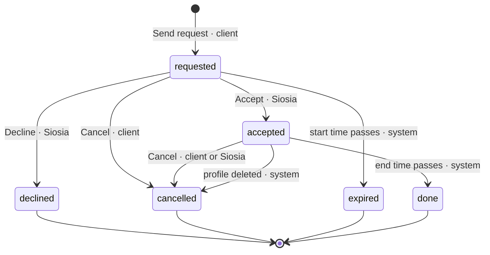

# Siosia 2.0 — Service Catalog Specification

**Created**: 2026-10-20 · **Author**: Roman · **Status**: Draft v2.0 for review · **Builds on**: [`siosia-spec-v0.1.md`](siosia-spec-v0.1.md) and the v1 code as of commit `619544e`

Siosia 2.0 turns the ride-hailing app into an app for sharing services with your Siosia. A client asks for a service from a catalog — learning, childcare, a ride — for a date, a start time and a duration; the Siosia accepts or declines, and when she accepts she can add a ride to the appointment (she needs to get there, or back). Both sides keep the appointment in their schedule, and both are reminded one day and two hours before, with the status of the appointment and of its ride (confirmed or still pending). A lesson can repeat every week, and any appointment goes into Apple or Google Calendar with one tap. The app opens on three buttons: **Siosia** (the catalog), **Planned** (the schedule) and **History**. Everything v1 does — rides now or booked, dispatch, live tracking, drivers, notifications, master profiles, the iPhone app — stays and becomes one entry of the catalog.

## 1. Scope

2.0 delivers the service loop — request, answer, ride as part of the service, reminders, schedule, history — on top of the complete v1 ride loop, for the same bounded pilot group, at the same zero running cost. Status: draft for review. Section numbers in this document refer to this document; v1 sections are cited as *v0.1 §n*.

**Goal.** One link, one app, three buttons. A client opens the app, taps *Siosia*, picks a service, a time and how long, and sends the request. The Siosia sees it in *Planned*, accepts, adds the ride she needs, and both of them are reminded the day before and two hours before with "ride: confirmed" or "ride: no driver yet". Nothing else to install, nothing to pay for.

**Who uses it**

| Role | Wants | Gets in 2.0 |
| --- | --- | --- |
| Client (receives the service; v1 rider) | Help at a known time: a lesson, someone with the kids, a ride | The catalog, a request form with date, start, duration, place and a note, the answer as a notification, the appointment in *Planned*, reminders with the ride status, history |
| Siosia (provides the service; v1 driver generalised) | To see what is asked of her, answer, get there and back, keep her schedule | Requests to answer in *Planned*, Accept with a ride attached, her schedule in both roles, the same reminders, history |
| Driver (v1, unchanged) | To take rides ahead or on demand | Rides to take in *Planned*, Go online from the catalog, the v1 driver screens |
| Operator | No new cost or maintenance | The catalog as configuration (one SQL call or the demo config file), the same free tiers, an idempotent database upgrade |

A person may hold several roles: Toria is a client, Roman drives, a Siosia may offer childcare and also need rides. The two sides of one appointment are always two different users.

**Scale ceiling** (adds to *v0.1 §1*): ≤ 200 appointments per month, ≤ 10 providers, ≤ 10 open appointments per client. The free-tier budget of *v0.1 §10* holds with room to spare (section 10).

**In scope for 2.0**

- Start screen with *Siosia*, *Planned*, *History* (section 3)
- A configurable service catalog; *Ride* is one of its entries and opens the v1 rider flow (section 4)
- Service requests with type, date, start time, duration, place and note, addressed to one provider; accept and decline (sections 5, 6)
- A ride attached to an accepted appointment, there and back, by either party, run by the v1 booking machinery (section 7)
- Reminders 1 day and 2 hours before, to both parties, with the appointment and ride status; event notifications for every step (section 8)
- *Planned* as the schedule of both roles, *History* as the merged past (section 9)
- Recurring appointments: a request may repeat weekly or every two weeks as a series the Siosia answers as a whole; her rides repeat with it (sections 6, 7)
- *Add to calendar*: any confirmed appointment, series or booked ride into Apple Calendar (.ics) or Google Calendar, with the reminders as alarms (section 8)
- Profile additions: *My place* and *Services I offer* (section 9)
- Demo mode with a robot Siosia; EN and PL; docs and guide updated

**Out of scope for 2.0** (recorded so nobody adds them by accident)

- Payments, invoices, hourly billing — a price may be shown, money changes hands outside the app (as *v0.1* FR-053)
- Availability calendars, working hours (a Siosia declines what she cannot do)
- Chat, calls, photos, documents
- A subscription feed of the whole schedule (webcal); 2.0 adds calendar events one at a time
- Counting late cancellations of appointments (decision of 2026-10-20, section 16); the v1 ride counters stay
- Requests broadcast to every provider offering a type (a request goes to one chosen Siosia; see Q13)
- Admin UI; the operator edits the catalog with one SQL call

## 2. From v1 to 2.0

What carries over and what changes. The v1 ride loop is kept as is; 2.0 wraps it.

| Topic | v1 (*v0.1*) | 2.0 |
| --- | --- | --- |
| Start screen | S1: *Ride* / *Drive* mode cards, mode remembered per device | S1: *Siosia* / *Planned* / *History*; no sticky mode; an active ride or an online driver reopens where it was (FR-082) |
| Roles | Rider, driver | Client, provider ("Siosia") and driver; rider = client of the *Ride* entry, driver = provider of the *Ride* entry |
| What can be asked for | A ride now or booked for later | Any catalog entry for a date, start and duration; *Ride* keeps the v1 form |
| Who answers | Every driver in range (dispatch), first accept wins | One chosen Siosia accepts or declines; rides still go to dispatch |
| Schedule | *My bookings* / *Booked rides* panels | *Planned*: appointments and rides, both roles, grouped by day |
| History | *Ride history*, *Earnings & history* | *History*: appointments and rides merged; earnings on top for drivers |
| Notifications | Booking and ride events | Plus appointment events and two reminders per appointment, both sides |
| Profile | Nickname, language, vehicle, account | Plus *My place* and *Services I offer*; *Switch mode* removed |
| Master profiles | One role: rider (fixed fare, default places) or driver (preset car) | Same for rides; a master profile also presets what it offers |
| Data | Rides, offers, ratings | Plus appointments and series; a ride may belong to an appointment |
| Recurring | — | A request may repeat weekly or every two weeks; one answer covers the series; rides repeat with it |
| Calendar | — | *Add to calendar* on appointments, series and booked rides: Apple Calendar (.ics) or Google Calendar |
| Server rules | Engine in the browser = SQL twin | Same rule, same tests, extended |

## 3. Start screen and navigation

**S1 Home** shows a greeting with the nickname (as today), the demo banner and the app hint when they apply, and three large buttons:

| Button | Opens | Badge (from the user's live state) |
| --- | --- | --- |
| **Siosia** | C1 the catalog | Providers: "N to answer" while requests wait for them |
| **Planned** | P1 the schedule | Count of upcoming items and the next one: "Next: Childcare, today 14:00" |
| **History** | H1 the past | — |

Below them the v1 footer stays: language, *How it works*, profile / sign-in. The *Ride* and *Drive* mode cards are gone from S1; *Ride* is the first catalog entry and *Drive* is the provider's *Ride — Go online* card in the catalog.

**Opening rules**

1. The app opens on S1.
2. If the user has an active ride in either role (requested … in\_progress) or an offer card, it opens on that ride screen (R2–R4, D2–D4), as the v1 "screen follows the active ride" rule.
3. If the user is online as a driver, it opens on D1. Leaving D1 (offline) returns to S1.
4. `?mode=ride` opens R1 and `?mode=drive` opens D1 (kept from v1); `?open=siosia|planned|history` opens that screen. A notification tap opens `?open=planned`.
5. Browser back always leads back towards S1; no screen is a dead end.

**Screen list** (new ids; v1 ids R1–R5 and D1–D6 keep their meaning, S2–S4 are extended)

| Id | Screen | Who | Shows / lets the user do |
| --- | --- | --- | --- |
| S1 | Home | all | *Siosia*, *Planned*, *History*; language, guide, profile |
| S2 | Profile | all | v1 fields plus *My place* (label + pin or address) and *Services I offer* (toggles); *Switch mode* removed |
| C1 | Catalog ("Siosia") | all | Entries with icon, name, description, duration hint, price if set, who offers it; *Ride* opens R1; providers see *You offer* first: *Ride — Go online* (D1) with the count of rides to take, and their other offered entries |
| C2 | Request form | client | Provider (preselected when only one offers it), date and start time, duration, repeat (none, weekly, every 2 weeks; until a date or a number of times), place (default *My place*), note, price preview, *Send request* |
| C3 | Appointment | both | Everything the viewer may see: service, time range, the other party, place, note, status, attached rides with status; actions: *Accept* / *Decline* (provider, while requested), *Add ride there* / *Add ride back* (for a series: *for all remaining*), *Remove ride* (passenger), *Add to calendar*, *Cancel* (for a series: *This one* / *All remaining*) |
| C4 | Accept sheet | provider | Opens on *Accept*: optional *I need a ride there* / *… back* with prefilled places and times (section 7); on a series the ticks apply to every occurrence; *Confirm* |
| P1 | Planned | all | *To answer* (providers), *Rides to take (N)* (drivers), then upcoming items grouped by day with status chips and actions |
| P2 | Rides to take | drivers | The v1 open-bookings list (distance from here, *Take this ride*) inside P1 |
| H1 | History | all | Finished appointments and rides, newest first; earnings today / this month for drivers |
| R1–R5, D1–D6 | v1 rider and driver screens | — | Unchanged; reached from C1 (R1, D1), from P1 (bookings) and by the opening rules |

## 4. Service catalog

The catalog is deployment configuration, not code. The operator sets it once; clients read it with the rest of the deployment config.

**Catalog entry**

| Field | Meaning | Rule |
| --- | --- | --- |
| `id` | Stable key, e.g. `learning` | `^[a-z][a-z0-9_]{1,23}$`; never reused; an entry is disabled, not deleted, so old appointments still resolve |
| `kind` | `ride` or `time` | Exactly one entry has kind `ride` (id `ride`): it opens the v1 rider flow and is provided by drivers. `time` entries create appointments |
| `name`, `description` | `{en, pl}` | Shown in the user's language; ≤ 40 / ≤ 160 characters |
| `icon` | One emoji or a profile-icon id | Shown on C1, P1, H1 and in reminders |
| `duration` | `{default, min, max, step}` minutes | `15 ≤ min ≤ default ≤ max ≤ 1440`, step 15 or 30; `time` entries only |
| `price` | `null`, `{perHour}` or `{fixed}` in the deployment currency | Optional; shown on C1 and C2 and frozen on the appointment; never charged |
| `needsPlace` | Whether a place is required | Default true (childcare happens somewhere); false allows an online lesson |
| `enabled` | Shown and requestable | Disabled entries stay resolvable for history |

**Defaults seeded on first run** (the operator edits them):

| id | kind | name EN / PL | duration (default, min–max, step) | price |
| --- | --- | --- | --- | --- |
| `ride` | ride | Ride / Przejazd | — (v1 form: now or booked) | v1 tariff or the master profile's fixed fare |
| `learning` | time | Learning / Nauka | 60, 30–240, 30 | none |
| `childcare` | time | Childcare / Opieka nad dziećmi | 180, 60–720, 30 | none |

At most 12 entries. The operator sets the catalog with `siosia_set_services(jsonb)` (SQL editor, service role), the demo backend reads `deployment.services` from `config.json`; `siosia_config()` returns the enabled entries to clients.

**Who offers what.** A provider turns entries on under *Services I offer* on S2 (`profiles.offers`). *Ride* is offered by having a vehicle and going online (v1 FR-004), not by a toggle. A master profile presets `offers` for every phone that uses it: the driver master (Roman) offers `ride`, the rider master (Toria) offers nothing; the operator changes this with `siosia_set_master`. C1 shows under each entry who offers it — nickname, icon and rating, never a user id (FR-143) — and disables an entry nobody offers ("Nobody offers this yet").

**Price.** When an entry has a price, C2 shows the resulting amount for the chosen duration ("2 h · 80 PLN"), the appointment freezes it, and P1/H1 show it. No entry has a price by default (Q10). Money is settled outside the app.

## 5. User stories and acceptance scenarios

Numbered on from *v0.1* US1–US8. P1 stories are 2.0's MVP.

### US9 — Client requests a service from the catalog (P1)

A client opens the app, taps *Siosia*, picks *Childcare*, sees that Siosia offers it, chooses tomorrow 14:00 for 3 hours at *My place*, writes "Kids back from school at 14:30", and sends. The request shows in *Planned* as "Waiting for Siosia", and Siosia gets a notification.

**Independent test**: two tabs on the demo backend; the request appears in both *Planned* lists within 1 s with the right time range and status.

1. **Given** the catalog shows *Childcare* offered by one provider, **When** the client opens it, **Then** C2 preselects that provider, defaults the duration to 3 h and the place to *My place*, and *Send request* is disabled until the time is at least 30 min ahead.
2. **Given** a valid form, **When** the client taps *Send request*, **Then** the appointment is `requested`, P1 lists it under tomorrow with "Waiting for Siosia", and the provider receives *New request: Childcare, Wed 22 Oct, 14:00–17:00*.
3. **Given** the client already has 10 open appointments, **When** they send one more, **Then** the server refuses with `too_many` and the form says so.
4. **Given** an entry nobody offers, **When** C1 shows it, **Then** it is disabled with "Nobody offers this yet".

### US10 — Siosia answers; the appointment lands in both schedules (P1)

Siosia opens *Planned*, sees *To answer: 1*, reads the request and taps *Accept*. The client is notified; both see "Confirmed" in *Planned*. Had she tapped *Decline*, the client would see "Declined" in *History* and could ask someone else or another time.

**Independent test**: accept in one tab; the other tab's P1 shows "Confirmed" within 1 s; decline another request; it moves to H1 as "Declined".

1. **Given** a `requested` appointment, **When** the provider taps *Accept*, **Then** C4 opens (ride options, section 7); on *Confirm* the appointment is `accepted`, the client is notified *Siosia accepted*, and both P1 lists show "Confirmed".
2. **Given** the provider already has an accepted appointment or a taken booking overlapping the time, **When** she accepts, **Then** the server refuses with `overlap` and names the clash.
3. **Given** a `requested` appointment, **When** the provider taps *Decline*, **Then** it is `declined`, the client is notified, and it leaves both P1 lists.
4. **Given** a `requested` appointment whose start time passes without an answer, **When** the server sweeps, **Then** it is `expired` and the client is notified *No answer from Siosia*.

### US11 — A ride as part of the service (P1)

On *Accept*, Siosia ticks *I need a ride there*. The sheet prefills pickup = her *My place*, dropoff = the appointment place, pickup time = 14:00 minus the route time minus 10 minutes. The ride is a normal booking: Roman sees it under *Rides to take* and takes it. Both Siosia and the client now see "Ride there 13:20 · Roman ✓"; before that they saw "no driver yet".

**Independent test**: three tabs (client, Siosia, driver) or the robot drivers; the ride line on the client's P1 goes from "no driver yet" to the driver's name within 1 s of *Take this ride*.

1. **Given** an `accepted` appointment, **When** the passenger adds a *there* ride, **Then** a `scheduled` ride linked to the appointment exists with pickup time before the start, the fare frozen, and drivers are notified *New booking* as in v1.
2. **Given** an attached ride without a driver, **When** a driver takes it, **Then** the passenger gets *Roman will drive you* (v1) and the other party gets *Ride confirmed: Roman*; P1 shows the driver's name on both sides.
3. **Given** an attached ride, **When** the non-passenger looks at C3, **Then** they see leg, pickup time, status and driver — not the passenger's pickup or dropoff.
4. **Given** an attached ride whose derived pickup time is less than 30 min ahead, **When** the sheet opens, **Then** *Add ride* is disabled with "Too soon to book — request a ride from *Siosia → Ride* when it's time".
5. **Given** an appointment with rides, **When** either party cancels the appointment, **Then** rides not yet in progress are cancelled, their drivers notified, and the appointment shows "Cancelled" in H1.

### US12 — Reminders one day and two hours before, with the ride status (P1)

The day before at 14:00 and again at 12:00, both the client and Siosia receive *Tomorrow 14:00–17:00: Childcare* / *In 2 hours: Childcare* with "Confirmed · Ride there: Roman ✓" or "Ride there: no driver yet". A client whose request is still unanswered reads "Waiting for an answer from Siosia"; the provider reads "Please answer".

**Independent test**: engine and SQL tests with a faked clock: exactly one reminder per party per slot, correct words for every status combination, none after cancel.

1. **Given** an `accepted` appointment with a confirmed ride, **When** the clock reaches start − 24 h, **Then** both parties are queued one reminder each within 1 min, naming the service, the range, the other party, the place, "Confirmed" and "Ride there: Roman ✓".
2. **Given** the same appointment at start − 2 h with the ride still without a driver, **When** the sweep runs, **Then** the reminders say "Ride there: no driver yet".
3. **Given** an appointment requested 20 h before its start, **When** start − 24 h is already past, **Then** no day-before reminder is sent; the 2 h one is.
4. **Given** a cancelled or declined appointment, **When** a reminder moment passes, **Then** nothing is sent.
5. **Given** a user without notifications on, **When** they open *Planned*, **Then** the item carries the same words ("Tomorrow", "In 2 h", ride status) in the list.

### US13 — Planned and History are the schedule (P1)

*Planned* shows, day by day, everything coming up in both roles: appointments as client or as Siosia, rides booked as rider or taken as driver, the active ride. *History* shows what is finished, newest first, with earnings for drivers.

**Independent test**: a user with one appointment as client, one as provider, one booking as rider and one taken booking as driver sees four items in P1 under the right days; after they finish, four items in H1.

1. **Given** items in both roles, **When** P1 opens, **Then** they are grouped Today / Tomorrow / weekday date, soonest first, an in-progress appointment on top as "Now until 17:00".
2. **Given** a driver with bookings to take, **When** P1 opens, **Then** *Rides to take (N)* lists them with the distance from here and *Take this ride*, as the v1 panel did.
3. **Given** a finished appointment and a completed ride, **When** H1 opens, **Then** both are listed with date, type, the other party, status and price or fare, and a driver sees today / this month totals above.

### US14 — My place and Services I offer (P2)

A client saves *My place* once, so every request starts there. A Siosia turns *Learning* and *Childcare* on under *Services I offer* and appears in the catalog.

1. **Given** no *My place*, **When** C2 opens, **Then** the place field is empty and the client sets it by pin or address; saving offers to keep it as *My place*.
2. **Given** a provider turns an entry off, **When** C1 refreshes, **Then** she no longer appears under it; her accepted appointments stay.
3. **Given** a rider master profile, **When** its S2 opens, **Then** *My place* is the master's default pickup and *Services I offer* is hidden.

### US15 — Changes and cancellations (P2)

Either side can cancel; attached rides follow; nothing is counted against anyone.

1. **Given** an `accepted` appointment 3 h ahead, **When** the client cancels, **Then** the provider is notified at once and the appointment is `cancelled` by client; no cancellation counter changes (decision of 2026-10-20).
2. **Given** a `requested` appointment, **When** the client cancels, **Then** nothing is counted and the provider is notified.
3. **Given** a provider cancels an `accepted` appointment, **When** attached rides exist, **Then** the passenger's rides are cancelled and their drivers hear *Booking cancelled*.

### US16 — Rating a service (P3)

Both parties may rate a `done` appointment once within 24 h; the stars feed the same per-user rating as rides.

1. **Given** a `done` appointment, **When** H1 opens within 24 h, **Then** it offers 1–5 stars and a comment; a second rating is refused with `already_rated`.

### US17 — A lesson every week (P2)

A client asks for *Learning* every Tuesday at 16:00 for an hour, eight times. Siosia accepts once; eight appointments land in both schedules, each with its own reminders, and her ride there repeats with them. Either side can cancel one occurrence or all remaining ones.

**Independent test**: two tabs; one request with *Repeat: weekly, 8 times* produces eight items on both P1 lists and one notification each way.

1. **Given** C2 with *Repeat* weekly and *Times* 8, **When** the client sends, **Then** the provider gets one *New request* naming "every Tuesday 16:00–17:00 from 28 Oct, 8 times" and P1 shows eight items with a repeat marker on both sides.
2. **Given** one occurrence clashes with a booking Siosia took, **When** she accepts, **Then** seven occurrences are `accepted`, the clashing one is `declined`, and both sides are told which date.
3. **Given** she ticked *I need a ride there* on *Accept*, **When** occurrences come within the booking horizon, **Then** each gets its booking without anyone touching the app — at once for the first ones, by the sweep for the rest.
4. **Given** the client cancels *All remaining* from the fifth occurrence, **When** they confirm, **Then** occurrences 5–8 are `cancelled`, their rides too, and Siosia gets one notification.
5. **Given** an unanswered series, **When** its first occurrence's start passes, **Then** the whole series expires with one notification to the client.

### US18 — Add to calendar (P2)

From an appointment, a series or a booked ride, *Add to calendar* puts the event into Apple Calendar or Google Calendar with the time, the place, the other party and the reminders as alarms.

**Independent test**: the Google link carries the right title, times, timezone, location and details; the `.ics` carries UID, alarms, RRULE for a series and STATUS:CANCELLED after cancellation.

1. **Given** an `accepted` appointment, **When** the client taps *Add to calendar → Google Calendar*, **Then** Google Calendar opens prefilled and the client taps *Save* there.
2. **Given** the same on an iPhone, **When** *Apple Calendar* is chosen, **Then** the `.ics` opens with *Add All*; the event carries alarms at the reminder slots and a link back to Siosia.
3. **Given** a series, **When** it is exported, **Then** the calendar gets one repeating event with cancelled and declined dates excluded.
4. **Given** a cancelled appointment, **When** its `.ics` link is opened again, **Then** the file marks the event cancelled, so adding it again removes it from the calendar.
5. **Given** the demo backend, **When** *Apple Calendar* is chosen, **Then** the `.ics` is built in the browser and downloaded.

## 6. Appointment lifecycle

Six statuses; two on the happy path, four terminal. Every transition is validated on the server by status and caller, exactly like rides (*v0.1 §5*).



"In progress" is not a stored status: an `accepted` appointment whose start has passed and whose end has not is shown as *Now*.

| From | To | Trigger | Who | Guard and side effects |
| --- | --- | --- | --- | --- |
| — | requested | *Send request* | client | Provider offers the entry and it is enabled; provider ≠ client; start ≥ now + 30 min and ≤ now + 30 days; duration within the entry's range and step; place given unless the entry allows none; note ≤ 200; ≤ 10 open and ≤ 20 new per day per client. Price frozen. Provider notified; both schedules updated. |
| requested | accepted | *Accept* | provider | No overlap with the provider's accepted appointments or taken bookings (`overlap`). Rides from C4 are created right after (section 7). Client notified. |
| requested | declined | *Decline* | provider | Client notified. Not counted. |
| requested | cancelled | *Cancel* | client | Provider notified. Not counted. |
| requested | expired | start time passes | system | Client notified *No answer*. |
| accepted | cancelled | *Cancel* | client or provider | Confirmation step. Other party notified. Attached rides not in progress are cancelled, their drivers notified. Nothing is counted (section 16). |
| accepted | done | end time passes | system | Rating window 24 h. Moves to H1. |
| requested / accepted | cancelled | profile of either party deleted | system | Reason `user_gone`; the other party notified; rides as above. |

**Series (recurring appointments).** A request with *Repeat* creates a series: one `appointment_series` row (rule weekly or every 2 weeks, 2–12 occurrences, the first start within `booking.maxDays`, the last within `appointment.seriesMaxDays`, default 91) and one appointment per occurrence, each living the lifecycle above with `series_id` and `seq`. The series is answered as a whole: *Accept* on any requested occurrence accepts every occurrence that does not clash with the provider's accepted appointments or taken bookings and declines the clashing ones; both parties are told the result in one notification each ("7 of 8 confirmed; declined: 11 Nov"). *Decline* declines all. An unanswered series expires as a whole, with one notification, when its first occurrence starts. After the answer, occurrences live on their own: done at their end, reminders per occurrence, rides per occurrence. *Cancel* on an occurrence offers *This one* or *All remaining* (every future requested or accepted occurrence; one notification to the other party). A cancelled or declined occurrence stays in the series as a gap, so the calendar export can exclude it.

**Timeline of one appointment** (defaults; every number is deployment configuration)

```
send ── T−24 h ── T−2 h ── pickup "there" ── T start ── T+duration end ── pickup "back"
        reminder  reminder  ride starts for    expired     done; rating       ride starts
        both      both      its driver         if still    24 h
                            (30 min before)    requested
```

Times are wall-clock times as picked, stored and shown exactly as picked (the v1 booking rule); the server clock decides when a moment has come.

## 7. Rides as part of a service

A ride attached to an appointment is a v1 advance booking with two extra fields: the appointment it belongs to and its leg. Nothing in dispatch, taking, starting, driving or paying changes.

**Rules**

1. Only an `accepted` appointment may have rides. Either party may add one; the party who adds it is the passenger (the ride's rider).
2. Two legs: *there* (arrive by the start) and *back* (leave at the end). At most one ride per (appointment, passenger, leg) — so at most four per appointment.
3. Prefill (C4 for the provider on *Accept*; C3 *Add ride* for either party later): *there* — pickup = passenger's *My place*, dropoff = the appointment place, pickup time = start − route duration − 10 min, floored to 5 min; *back* — the reverse places, pickup time = end + 5 min. The passenger may change places and time. Route duration comes from the routing service with the v1 straight-line fallback.
4. Server guards on top of the v1 booking rules (lead ≥ 30 min, ≤ 30 days, no overlap with the passenger's other bookings, fare frozen, master fixed fare): a *there* ride's pickup time is before the start; a *back* ride's pickup time is at or after the start; the passenger is a party of the appointment; the leg is free; the appointment is `accepted`.
5. When the derived pickup time is less than 30 min ahead, the sheet refuses to book and points to *Siosia → Ride → Now* at the time (FR-112).
6. The ride then lives the v1 booking life: drivers take it in P2 ahead of time; untaken, it opens to dispatch 20 min before its pickup time and gives up 15 min after; a taken one starts its driver 30 min before. The passenger gets the v1 notifications (*New booking* to drivers, *Roman will drive you*, *Driver is on the way*, *Time to go*).
7. **Ride status** on the appointment, for both parties: *none* (no ride), *pending* (scheduled, no driver), *confirmed* (driver assigned: scheduled with a driver, accepted, arrived, in\_progress), *done* (completed), *failed* (expired or cancelled). Every change from pending to confirmed and back, and to failed, notifies the *other* party (`appt_ride_taken`, `appt_ride_lost`, `appt_ride_failed`), and the words reach the reminders (section 8).
8. The non-passenger party sees of the ride only its leg, pickup time, status and the driver's nickname and icon — not the passenger's pickup or dropoff (a *there* ride's dropoff is the appointment place they know anyway). The driver sees the ride as any booking — rider nickname, places, time — and nothing about the appointment.
9. The passenger may remove the ride (cancel the booking) without touching the appointment; cancelling the appointment cancels every attached ride that is not yet `in_progress`, reason `appointment_cancelled`, drivers notified with the v1 *Booking cancelled*.
10. An attached ride that fails does not fail the appointment: both parties are told *No driver found* and the appointment stays confirmed.
11. **Series.** The ride ticks on C4, and *Add ride … for all remaining* on C3, store a ride template on the series (passenger, leg, pickup, dropoff, time offset from the start or the end). Bookings are created from the template for every accepted occurrence whose pickup time is within `booking.maxDays`: at once for the first ones, then by the sweep (daily) as later occurrences enter the horizon. Each booking is a normal ride. The passenger may remove one occurrence's ride (the template stays) or end the template (*No more rides for this series*). Occurrences beyond the horizon show "ride: booked when within 30 days". To make room, the v1 cap of 5 open bookings per rider becomes `booking.maxOpen` (default 12), and template-created bookings do not count against the 10-new-per-day limit.

## 8. Reminders and notifications

Notifications are Web Push as in v1 (`push_outbox` → Edge Function `push-dispatch`, texts in `push-text.ts` shared with the demo backend, queued only for users with a subscription, in the recipient's language and the deployment's timezone). 2.0 adds ten kinds; the v1 kinds stay.

**Reminders.** For every `requested` or `accepted` appointment and each party, one reminder at start − 24 h and one at start − 2 h (`appointment.reminderMin`, default `[1440, 120]`), each at most once, queued by the server sweep within 1 min of the moment (the sweep already runs every 10 s under pg\_cron and on every API call). A reminder whose moment had already passed when the appointment was requested is skipped — no catch-up. Nothing is sent for declined, cancelled, expired or done appointments. The reminder words are the words P1 shows:

| Appointment status | Client reads | Provider reads |
| --- | --- | --- |
| accepted | Confirmed | Confirmed |
| requested | Waiting for an answer from {provider} | Please answer |

| Ride (per attached ride) | Both read |
| --- | --- |
| confirmed | Ride there: {driver} ✓ |
| pending | Ride there: no driver yet |
| failed | Ride there: no driver found |
| none | (no ride line) |

**Kinds and texts** (EN / PL; `{range}` = "Wed 22 Oct, 14:00–17:00", `{when}` = "Wed 22 Oct, 14:00", `{lead}` = "Tomorrow" / "In 2 hours" from the slot, `{leg}` = there / back, `{status}` and `{rides}` from the tables above)

| Kind | To | Title | Body |
| --- | --- | --- | --- |
| `appt_new` | provider | New request: {service} {when} / Nowa prośba: {service} {when} | {client} asks for {service}, {range}. Answer in Siosia → Planned. / {client} prosi o: {service}, {range}. Odpowiedz w Siosi → Zaplanowane. |
| `appt_accepted` | client | {provider} accepted / {provider} potwierdza | {service} {range} is confirmed. / {service} {range} — potwierdzone. |
| `appt_declined` | client | {provider} can't make it / {provider} nie może | {service} {range} was declined. / {service} {range} — odrzucone. |
| `appt_cancelled` | other party | {service} {when} cancelled / {service} {when} odwołane | Cancelled by {who}: {service} {range}. / Odwołane przez: {who}. {service} {range}. |
| `appt_expired` | client | No answer from {provider} / Brak odpowiedzi od {provider} | {service} {range} got no answer and expired. / {service} {range} — bez odpowiedzi, prośba wygasła. |
| `appt_reminder` | both | {lead}: {service} {range} / {lead}: {service} {range} | With {other} · {place}. {status}. {rides} / Z {other} · {place}. {status}. {rides} |
| `appt_ride_added` | other party | {who} added a ride / {who} dodaje przejazd | {service} {when}: ride {leg} at {time}, looking for a driver. / {service} {when}: przejazd {leg} o {time}, szukamy kierowcy. |
| `appt_ride_taken` | other party | Ride confirmed: {driver} / Przejazd potwierdzony: {driver} | {service} {when}: the ride {leg} has a driver. / {service} {when}: przejazd {leg} ma kierowcę. |
| `appt_ride_lost` | other party | Ride needs a driver / Przejazd szuka kierowcy | {service} {when}: the ride {leg} has no driver again. / {service} {when}: przejazd {leg} znów bez kierowcy. |
| `appt_ride_failed` | both | No driver found / Nie znaleziono kierowcy | {service} {when}: the ride {leg} didn't happen. / {service} {when}: przejazd {leg} nie doszedł do skutku. |

Polish legs: *there* = "tam", *back* = "powrotny" ("przejazd tam" / "przejazd powrotny"). `{lead}` in Polish: "Jutro" / "Za 2 godziny"; any other configured slot reads "In {n} h" / "Za {n} godz.". Tags are `<kind>:<appointment id>` so a newer notification replaces an older one of the same kind and appointment; every payload opens `./?open=planned`. The passenger of an attached ride keeps the v1 ride notifications and does not get the `appt_ride_*` ones (no doubles).

For a series, `{range}` reads "every Tue 16:00–17:00, 28 Oct – 16 Dec (8×)" / "co wtorek 16:00–17:00, 28 paź – 16 gru (8×)"; an answer with clashes adds "7 of 8 confirmed; declined: 11 Nov" / "7 z 8 potwierdzone; odrzucone: 11 lis"; *All remaining* sends one `appt_cancelled` with "from 25 Nov, 4 left" / "od 25 lis, 4 pozostałe". Reminders stay per occurrence.

**In the app.** The demo backend shows every notification as the v1 toast; the real app shows the same information in P1 regardless of notifications: "Tomorrow" / "In 2 h" markers on the item, the status chips and the ride line. S1's *Planned* button names the next item.

**Add to calendar.** Every `accepted` appointment (C3 and the P1 item), every series and every booked ride offers *Add to calendar* with two choices:

- *Google Calendar*: opens the Google Calendar event template (`https://calendar.google.com/calendar/render?action=TEMPLATE&…`) prefilled with the title ("{service} with {other}"; rides: "Ride: {pickup} → {dropoff}"), start and end in the deployment timezone (`ctz`), location (the place label), details (the other party, the note, the ride lines the viewer may see, a link to Siosia) and, for a series, the repeat rule (`recur=RRULE:FREQ=WEEKLY;INTERVAL=1|2;COUNT=n`). The user taps *Save* there. It works on any phone and Siosia stores nothing.
- *Apple Calendar* (and any app that reads `.ics`): opens a per-event `.ics` served by a small Edge Function `calendar` next to `push-dispatch` (same free tier): `<calendarUrl>?a=<appointment id>&u=<viewer public id>&t=<token>` (series: `s=<series id>`; rides: `r=<ride id>`). The token is an HMAC of the ids with the deployment's `push_secret`, so only the two parties, who get the link inside the app, can fetch it. On iPhone the link opens the event preview with *Add All*; on Android it opens in the calendar app. The file carries `UID` = the record id (adding again updates instead of duplicating), `SUMMARY` as above, `DTSTART`/`DTEND` in UTC, `LOCATION` and `GEO` from the place, `DESCRIPTION` with the note and the ride lines the viewer may see (FR-114), a `URL` back to Siosia (`?open=planned`), one `VALARM` per configured reminder slot (rides: one, 30 min before), `RRULE` plus an `EXDATE` per cancelled or declined occurrence for a series, and `STATUS:CANCELLED` once cancelled so a re-import removes it.
- The demo backend has no server: it builds the `.ics` in the browser from the same shared module and offers it as a download; the Google link is the same. When the deployment has no `calendarUrl`, only the Google choice shows.

The calendar entry is a copy: later changes in Siosia do not reach the phone's calendar (a subscription feed is out of scope); the action says so once ("Added events don't update by themselves — open the link again after a change").

## 9. Functional requirements

Numbered on from *v0.1* FR-076; gaps are room for additions. Every requirement is testable without knowing the stack.

**Start screen and navigation**

- **FR-080**: S1 MUST show three primary buttons — *Siosia*, *Planned*, *History* — with the v1 footer (language, guide, profile / sign-in); the v1 *Ride* and *Drive* mode cards MUST NOT appear on S1.
- **FR-081**: *Siosia* MUST open C1, *Planned* P1, *History* H1; each MUST have a Back to S1 and MUST honour browser back.
- **FR-082**: On launch the app MUST open S1, except: with an active ride or an offer card in either role it opens that ride screen; with the driver online it opens D1. Going offline on D1 and finishing or leaving a ride return to S1. No "last mode" is remembered.
- **FR-083**: S1 MUST badge *Siosia* with the number of requests waiting for the user's answer and *Planned* with the number of upcoming items and the next one ("Next: Childcare, today 14:00"); the counts come from the user's live state and refresh on realtime changes.
- **FR-084**: `?mode=ride` MUST open R1 and `?mode=drive` D1 (v1 FR-001 kept); `?open=siosia|planned|history` MUST open that screen; both parameters are removed from the URL once used.
- **FR-085**: Master-profile restrictions apply to the *Ride* entry only: a rider master cannot offer rides (`rider_only`), a driver master cannot request rides (`driver_only`); both MAY request and offer other entries as the master's `offers` preset allows.

**Catalog**

- **FR-090**: C1 MUST list every enabled catalog entry with icon, name, description, duration hint and price when set, and who offers it (nickname, icon, rating); an entry nobody offers MUST be shown disabled with "Nobody offers this yet"; the viewer never appears under an entry as a provider of their own request.
- **FR-091**: The catalog MUST be deployment configuration with the fields of section 4; defaults `ride`, `learning`, `childcare` MUST be seeded on first run; at most 12 entries; entries MUST be disabled, never deleted.
- **FR-092**: The *Ride* entry MUST open R1 unchanged (now or later, bookings, master default places and fixed fare); for a user with a vehicle C1 MUST show *You offer* first with *Ride — Go online* opening D1 and the number of rides to take.
- **FR-093**: Providers MUST choose what they offer on S2 (*Services I offer*: one toggle per `time` entry), stored on the profile; a master profile's `offers` MUST apply to every phone using it and hide the toggles.
- **FR-094**: Tapping a `time` entry MUST open C2 with: provider (preselected when exactly one offers it, otherwise a choice), date and start time (step 15 min, at least `booking.minLeadMin` ahead, at most `booking.maxDays` ahead), duration (the entry's min…max by step, default preset), repeat (none, weekly, every 2 weeks; *Until* a date or *Times* 2–12), place (default *My place*; pin or address like R1; may be empty only when the entry allows), note ≤ 200 characters, the price for the chosen duration when set (per occurrence for a series), and *Send request* disabled until valid.

**Appointments**

- **FR-100**: *Send request* MUST create a `requested` appointment addressed to one provider; the server MUST validate the entry, the provider's offer, the time window, the duration, the place, the note and the limits (≤ 10 open single appointments and ≤ 3 open series per client, ≤ 20 new requests per day with a series counting once), MUST freeze the price, MUST notify the provider (`appt_new`) and MUST make the item appear in both P1 lists at once.
- **FR-101**: The provider MUST be able to *Accept* (via C4) or *Decline* a `requested` appointment from P1 and C3; *Accept* MUST fail with `overlap` when the time overlaps another accepted appointment or a taken booking of the provider; the client MUST be notified of either answer.
- **FR-102**: Either party MUST be able to cancel a `requested` or `accepted` appointment until its start, with a confirmation step once accepted; the other party MUST be notified; attached rides not yet `in_progress` MUST be cancelled with reason `appointment_cancelled` and their drivers notified; the appointment MUST record who cancelled and when, and MUST NOT count on anyone's profile (the v1 ride counters of FR-064 are untouched).
- **FR-103**: A `requested` appointment unanswered at its start time MUST become `expired` server-side with the client notified; an `accepted` one MUST become `done` at its end time; "in progress" MUST be derived (accepted, start ≤ now < end) and shown as *Now* in P1.
- **FR-104**: Every transition MUST be validated server-side by current status and caller role; the server clock decides; both backends MUST implement the same rules (the engine is the SQL's twin, tested alike).
- **FR-105**: An appointment MUST store only: both parties, the entry id, start (wall-clock as picked), duration, place (lat, lng, label) or none, note, price snapshot, timestamps, who cancelled and why, and which reminders went out — nothing else about location.
- **FR-106**: Both parties MAY rate a `done` appointment once within 24 h (1–5 stars, comment ≤ 140); the rating MUST feed the same per-user summary as rides (v1 FR-060, FR-061).
- **FR-107**: C2 MUST offer *Repeat* (none, weekly, every 2 weeks) with *Until* a date or *Times* 2–12; a repeating request MUST create one series and one appointment per occurrence, the first start within `booking.maxDays`, the last within `appointment.seriesMaxDays` (default 91), at most `appointment.seriesMaxCount` (default 12) occurrences, all with the same provider, duration, place, note and price; the provider MUST get one `appt_new` naming the rule, the first date and the count.
- **FR-108**: *Accept* on a requested series MUST accept every occurrence that does not overlap the provider's accepted appointments or taken bookings and MUST decline the clashing ones, telling both parties which dates in one notification each; *Decline* MUST decline all; an unanswered series MUST expire as a whole when its first occurrence starts; after the answer each occurrence MUST follow FR-103.
- **FR-109**: *Cancel* on an occurrence of a series MUST offer *This one* and *All remaining* (every future `requested` or `accepted` occurrence); either MUST notify the other party once and MUST cascade to the occurrences' rides as FR-102; P1 MUST mark occurrences with the repeat rule and C3 MUST show the series line (rule, remaining, until).

**Rides as part of a service**

- **FR-110**: Either party of an `accepted` appointment MUST be able to attach rides with leg *there* and leg *back*, at most one per leg per passenger; the party who adds it is the passenger; the ride MUST be a v1 advance booking linked to the appointment and its leg.
- **FR-111**: The ride sheet MUST prefill places and pickup times as section 7 rule 3; the passenger MAY change them; the server MUST enforce *there* before the start, *back* at or after the start, the passenger being a party, the leg being free, the appointment being `accepted`, and every v1 booking rule.
- **FR-112**: When the derived pickup time is less than `booking.minLeadMin` ahead, the sheet MUST refuse to book and MUST tell the user to request a ride from *Siosia → Ride* at the time.
- **FR-113**: Attached rides MUST follow the v1 booking lifecycle unchanged; the appointment MUST summarise each as *none*, *pending*, *confirmed*, *done* or *failed* (section 7 rule 7) for both parties.
- **FR-114**: The non-passenger party MUST see of an attached ride only its leg, pickup time, status and the driver's nickname and icon; the driver MUST see the ride as a plain booking and nothing about the appointment.
- **FR-115**: The passenger MUST be able to remove an attached ride without affecting the appointment; drivers are notified as in v1.
- **FR-116**: A change of an attached ride's status between *pending*, *confirmed* and *failed* MUST notify the non-passenger party (`appt_ride_taken`, `appt_ride_lost`, `appt_ride_failed`); the passenger keeps the v1 ride notifications and gets no doubles.
- **FR-117**: On a series, the C4 ride ticks and *Add ride … for all remaining* MUST store a ride template (passenger, leg, places, time offset) on the series; the server MUST create the booking of every `accepted` occurrence whose pickup time is within `booking.maxDays` — at once, then daily by the sweep as occurrences enter the horizon; the passenger MUST be able to remove one occurrence's ride or end the template; `booking.maxOpen` (default 12) MUST replace the v1 cap of 5 open bookings per rider, and template bookings MUST NOT count against the daily limit.

**Reminders and notifications**

- **FR-120**: For every `requested` or `accepted` appointment, both parties MUST get a reminder at start − 24 h and at start − 2 h (`appointment.reminderMin`, default `[1440, 120]`), each at most once per party per slot, queued server-side within 1 min of the moment and delivered as Web Push to the user's subscribed devices.
- **FR-121**: A reminder MUST name the service, the time range, the other party, the place, the appointment status in the words of section 8 and the status of every attached ride in the words of section 8 — identical to what P1 shows.
- **FR-122**: A reminder whose moment had already passed when the appointment was requested MUST be skipped; no reminder MUST be sent for a declined, cancelled, expired or done appointment.
- **FR-123**: Users without notifications MUST see the same information in P1 (*Tomorrow* / *In 2 h* markers, status chips, ride line) and on S1's *Planned* badge; the notifications-off hint on S2 MUST mention appointment reminders.
- **FR-124**: Event notifications MUST follow the table of section 8: right recipient only, recipient's language, deployment timezone, tag `<kind>:<appointment id>`; the demo backend MUST show them in the page as v1 does.
- **FR-125**: A notification tap MUST open the app on P1.

**Planned and History**

- **FR-130**: P1 MUST list every upcoming item of the user in both roles — appointments (`requested`, `accepted`, in progress first) and rides (`scheduled` bookings as rider or as the driver who took them, active rides) — grouped Today / Tomorrow / weekday date, soonest first, each with status chips, the ride line and the actions the viewer may take.
- **FR-131**: For providers P1 MUST start with *To answer* (requested appointments addressed to them, with *Accept* / *Decline*); for drivers P1 MUST include *Rides to take (N)* — the v1 open-bookings list with distance and *Take this ride* — and *Give back* on taken ones.
- **FR-132**: Tapping an appointment MUST open C3 with everything the viewer may see (FR-114) and the actions; tapping a ride MUST open the v1 booking card.
- **FR-133**: H1 MUST merge finished appointments (`done`, `declined`, `cancelled`, `expired`) and finished rides (`completed`, `cancelled`, `expired`) in both roles, newest first, the last 50 of each, with date, type, the other party, status and price or fare; drivers MUST see today / this month earnings on top (v1 FR-027); the v1 *Ride history* and *Earnings & history* panels are replaced by H1.
- **FR-134**: P1 and H1 MUST refresh on realtime changes and every 30 s while open and MUST show loading, empty and error states in EN and PL.
- **FR-135**: C3, the P1 appointment item and the P1 booking card MUST offer *Add to calendar* with *Google Calendar* (the prefilled event template link of section 8 with title, start, end, timezone, location, details and the repeat rule for a series) and *Apple Calendar / .ics* (the per-event `.ics` link of section 8; hidden when the deployment has no `calendarUrl`; built in the browser and downloaded on the demo backend), and MUST say once that added events do not update by themselves.
- **FR-136**: The `.ics` MUST contain only what the viewer may see (FR-114), MUST be served only with a valid token for that viewer, MUST carry UID = record id, one alarm per reminder slot (one at −30 min for rides), `RRULE` with `EXDATE`s for a series, `STATUS:CANCELLED` after cancellation and a link back to Siosia, and MUST never contain positions or another user's id; the same module MUST produce the file on the server and in the demo browser.

**Profile**

- **FR-140**: S2 MUST add *My place* (label plus pin or address, set like an R1 field), used as the default appointment place for clients and the default ride pickup for passengers; a rider master's default pickup is its *My place*; and *Services I offer* (FR-093).
- **FR-141**: *Switch to Ride* / *Switch to Drive* MUST be removed from S2; vehicle, notifications, app install, account, privacy and delete stay.
- **FR-142**: Deleting a profile MUST cancel its upcoming appointments in both roles (system, `user_gone`) with the other parties notified, and MUST anonymise finished ones as v1 does with rides.
- **FR-143**: The catalog and the request MUST identify a provider by a random per-profile public id, never by the auth user id (v1 NFR-06, NFR-07 unchanged).

**Configuration, demo, platform**

- **FR-150**: The catalog and the appointment settings (`reminderMin`, `seriesMaxDays`, `seriesMaxCount`, `booking.maxOpen`, `calendarUrl`) MUST be deployment configuration: `app_config.services` and columns set by the operator with `siosia_set_services(jsonb)` and plain updates; the demo backend MUST read `deployment.services` and `deployment.appointment` from `config.json`; `siosia_config()` MUST return the enabled catalog and the settings.
- **FR-151**: Demo mode MUST include a robot provider "Siosia" offering `learning` and `childcare` who accepts a request within 5 s and attaches a *there* ride when the start is at least 1 h ahead, so one tab can run the whole loop; two tabs MUST still be able to play client and provider.
- **FR-152**: Every new string MUST exist in EN and PL (`pl.ts` typed against `en.ts`); catalog names and descriptions MUST come from the catalog in both languages.
- **FR-153**: The in-app guide, `docs/USER-GUIDE.md`, `docs/ARCHITECTURE.md`, `docs/TRACEABILITY.md`, `docs/SETUP.md` (catalog) and `README.md` MUST describe 2.0.

## 10. Non-functional requirements

All of *v0.1 §8* stays. Additions:

| Id | Area | Requirement |
| --- | --- | --- |
| NFR-15 | Reminder timeliness | A reminder is queued within 1 min of its moment and delivered within 2 min on a deployment with pg\_cron (sweep every 10 s, sender every minute or on insert); without pg\_cron it is queued on the next API call of anyone, and the setup guide says so. |
| NFR-16 | Consistency | The words for appointment and ride status are one source in the client and one in `push-text.ts`, with a test that they match in both languages. |
| NFR-17 | Budget | At the scale ceiling (200 appointments/month, 10 notifications each) notifications add ≤ 2 000 pushes and ≤ 1 MB of rows per month; no new realtime channels; realtime messages grow by two `changed` events per appointment transition; the calendar function answers only user taps (hundreds of invocations per month at most, far inside the free function quota). |
| NFR-18 | Compatibility | A cached v1 client (PWA) keeps working against the 2.0 database until it updates: v1 server functions keep their names and signatures; new shapes get new names (section 12). |
| NFR-19 | Privacy | The note and the place of an appointment are visible to its two parties only, never to drivers (who see the ride) or to other members; a provider's *My place* never reaches a client (FR-114). The nickname remains the only profile field beyond *My place*, which the user sets knowingly. |
| NFR-20 | Calendar links | An `.ics` link is unguessable (record id plus an HMAC token bound to the viewer), is shown only inside the app to its two parties, answers with that viewer's view only, and the function logs no content; a link of a cancelled record still answers (with `STATUS:CANCELLED`) until retention deletes the record. A series exports as one event with exclusions, never as one file per occurrence. |

## 11. Data model

Durable records as in *v0.1 §9*; live positions stay ephemeral and unchanged.

**New and changed entities**

| Entity | Key attributes | Rules |
| --- | --- | --- |
| Appointment (`appointments`) | id, client id, provider id, service id, status (`requested`, `accepted`, `declined`, `cancelled`, `expired`, `done`), starts at, duration min, place (lat, lng, label) or null, note ≤ 200, price and currency or null, requested at, answered at, ended at, cancelled by (`client`, `provider`, `system`), cancel reason, reminded (array of slot minutes already sent), series id and seq (nullable) | Transitions as section 6, enforced server-side. Index on (provider id, status), (client id, status), (starts at) where status in (requested, accepted). RLS: readable by its two parties only; all writes through functions. |
| Series (`appointment_series`) | id, client id, provider id, service id, rule (`weekly`, `biweekly`), first start, duration min, count 2–12, until, place, note, price and currency, status (`requested`, `answered`, `cancelled`, `expired`), ride templates (jsonb: passenger, leg, pickup, dropoff, offset min), requested at, answered at | One row per repeating request; occurrences are `appointments` rows with `series_id` and `seq`; templates materialise bookings within the booking horizon (section 7 rule 11). RLS as appointments. |
| Ride (`rides`) | + appointment id (nullable), leg (`there`, `back`) | Unique (appointment id, rider id, leg). Cascade on appointment cancel (section 7 rule 9). A ride without an appointment is a v1 ride. |
| Profile (`profiles`) | + offers (entry ids), home (place jsonb or null), public id (random, unique) | `offers` only `time` entries; `public_id` is the only profile reference that reaches other clients; no appointment cancellation counters (section 16). |
| Master profile (`master_profiles`) | + offers (entry ids or null) | null = default by role (driver → `{ride}`, rider → `{}`); copied to the phone's profile on join, as the vehicle is. |
| Catalog (`app_config.services`) | jsonb array of entries (section 4) | Validated by `siosia_set_services`: ids unique and well-formed, one `ride`, ≤ 12, duration rules. |
| Appointment settings (`app_config`) | `appt_reminder_min int[]` default `{1440,120}`, `appt_series_max_days` default 91, `appt_series_max_count` default 12, `booking_max_open` default 12, `calendar_function_url` (null until the function is deployed) | Reminder slots 15…10080, at most 4, distinct; series count 2…12; horizon 30…365 days. |
| Rating (`ratings`) | + appointment id (nullable); ride id becomes nullable | Exactly one of ride id / appointment id; at most one per direction per ride or appointment; immutable. |
| Notification queue (`push_outbox`) | + appointment id (nullable) | Tag source for appointment kinds. |

**Derived, not stored**: in-progress state, ride status summary, P1 and H1 lists, S1 badges, the next item, earnings, displayed ratings.

**Realtime**: an insert or update on `appointments` sends the data-less `changed` event on `user:<id>` of both parties (as the rides trigger does); the client refetches. No new channels.

**Retention**: appointments and series follow rides — deleted 12 months after their end or last start by the daily retention job; `push_outbox` rows after 2 days. A deleted profile anonymises its finished appointments ("Deleted user") and cancels upcoming ones.

**Deployment config** (`siosia_config()` / demo `config.json`): `services` (enabled entries), `appointment: { reminderMin, seriesMaxDays, seriesMaxCount }`, `calendarUrl` (null = Google only), `booking.maxOpen`; `booking` (v1) also governs appointment lead time and the first start of a series.

## 12. Backend interface and server functions

Every screen talks to `Backend` (`src/backend/types.ts`); both the mock (engine) and Supabase implement every addition (*v0.1* D-02). New or changed members:

| Member | Shape | Server function (Supabase) |
| --- | --- | --- |
| `getConfig()` | `DeploymentConfig` + `services: CatalogEntry[]`, `appointment: { reminderMin: number[]; seriesMaxDays: number; seriesMaxCount: number }`, `calendarUrl: string \| null`, `booking.maxOpen` | `siosia_config()` |
| `catalog()` | `CatalogEntry[]` with `providers: PublicProvider[]` (`publicId`, nickname, icon, rating), excluding the caller | `siosia_catalog()` |
| `requestService(input)` | `{ serviceId, providerId (public), startsAt, durationMin, place: Place \| null, note, repeat?: { every: 1 \| 2; count?: number; until?: number } }` → `AppointmentView` (the first occurrence, with `series` set) | `siosia_request_service(text, text, timestamptz, int, jsonb, text, jsonb)` |
| `answerAppointment(id, "accept" \| "decline")` | → `AppointmentView`; on a series answers the whole series and lists the declined dates in `series.declined` | `siosia_answer_appointment(uuid, text)` |
| `cancelAppointment(id, reason?, scope?)` | `scope: "one" \| "series"` (default `one`) → void | `siosia_cancel_appointment(uuid, text, text)` |
| `setRideTemplate(seriesId, template)` | `{ leg, pickup, dropoff, offsetMin }` → `AppointmentView`; creates the bookings within the horizon at once | `siosia_set_ride_template(uuid, jsonb)` |
| `dropRideTemplate(seriesId, leg)` | → void; existing bookings stay | `siosia_drop_ride_template(uuid, text)` |
| `planned()` | `{ appointments: AppointmentView[]; rides: RideView[] }`, upcoming, both roles (replaces `bookings()` in the UI; `bookings()` stays) | `siosia_planned()` |
| `timeline()` | `HistoryItem[]` merged, ≤ 50 of each kind (replaces `history()` in the UI; `history()` stays) | `siosia_timeline()` |
| `openBookings(pos)` | unchanged | `siosia_open_bookings` |
| `bookRide(input)` | `BookingInput` + `appointmentId?`, `leg?: "there" \| "back"` | `siosia_book_ride(…, uuid, text)` — new overload, v1 signature kept |
| `setOffers(ids)` | → `Profile` | `siosia_set_offers(text[])` |
| `saveHome(place \| null)` | → `Profile` | `siosia_save_home(jsonb)` |
| `rateAppointment(id, stars, comment)` | → void | `siosia_rate_appointment(uuid, int, text)` |
| `myState()` | `MyState` + `toAnswer: number`, `planned: number`, `nextPlanned: { kind: "appointment" \| "ride"; at: number; title: string } \| null` | `siosia_my_state()` (extended JSON; v1 fields unchanged) |
| calendar links | `AppointmentView.calendar` and `RideView.calendar`: `{ google: string; ics: string \| null }`, built from the record (Google: in the client from the view; ics: the tokenised function link, null without `calendarUrl`) | `siosia_appointment_json` / `siosia_ride_json` add `calendar.ics` using pgcrypto `hmac(id ‖ viewer, push_secret, 'sha256')` |
| Edge Function `calendar` | `GET <calendarUrl>?a=<id>&u=<public id>&t=<token>` (`s=` series, `r=` ride) → `text/calendar`; 404 on a bad token; shares `supabase/functions/_shared/ics.ts` with the demo backend | Deno, service role, next to `push-dispatch` |
| operator | — | `siosia_set_services(jsonb)`, `siosia_set_master(…, offers text[])`; `app_config.calendar_function_url`, `booking_max_open` by plain update |

`AppointmentView`: id, status, `role: "client" | "provider"`, serviceId, startsAt, durationMin, endsAt, place or null, note, price or null, client and provider as `PublicParty`, requestedAt, answeredAt, endedAt, cancelledBy, cancelReason, `rides: AttachedRide[]` (rideId, leg, `passenger: "client" | "provider"`, scheduledFor, `status: "pending" | "confirmed" | "done" | "failed"`, driver as `PublicParty` or null; pickup and dropoff only when the viewer is the passenger), `reminders: number[]` (slots sent), myRating, `series: { id; rule: "weekly" | "biweekly"; seq; count; until; remaining; declined: number[]; rideTemplates: RideTemplate[] } | null`, `calendar: { google; ics }`. `RideView` gains `appointmentId`, `leg` and `calendar`.

**New error codes**: `bad_service` (unknown or disabled entry), `not_offered` (provider does not offer it), `no_provider` (public id unknown or gone), `bad_duration`, `not_accepted` (ride on a non-accepted appointment), `bad_leg`, `ride_exists`, `bad_repeat` (rule, count or horizon out of range). Reused: `bad_time`, `too_many`, `overlap`, `illegal_transition`, `not_found`, `forbidden`, `rider_only`, `driver_only`, `already_rated`, `window_closed`.

**Sweep additions** (`siosia_sweep()` and the engine's sweep, in this order before the v1 steps): cancel appointments of deleted users (`user_gone`); expire `requested` ones at their start; finish `accepted` ones at their end; expire an unanswered series as a whole when its first occurrence starts; queue reminders per slot and party (atomic mark, section 8); create template bookings for occurrences that entered the booking horizon (once a day per series, `FOR UPDATE SKIP LOCKED`); keep the v1 booking steps for attached rides, and after an attached ride's status changes queue the `appt_ride_*` events for the other party.

**Guarantees** (as *v0.1 §10* and `docs/ARCHITECTURE.md`): atomic answer (`UPDATE … WHERE id = … AND status = 'requested' AND provider_id = …`), guarded sweeps (`FOR UPDATE SKIP LOCKED`), reminders marked in the same statement that queues them so overlapping sweeps never double-send, no table readable across users, no user id across users.

## 13. Testing and acceptance

2.0 is accepted when the automated suite is green in CI and the field test passes on real phones, as v1.

| Level | What it covers | Runs where |
| --- | --- | --- |
| Unit (engine) | Appointment lifecycle, every legal and illegal transition and caller (§6); request validation and limits (FR-100); overlap on accept (FR-101); reminders with a faked clock — one per party per slot, skip when requested late, none after cancel, words per status combination (FR-120–122); attached rides — guards, prefill times, visibility, cascade, status summary and `appt_ride_*` events (FR-110–116); done / expired by the clock (FR-103); delete cascade (FR-142); series — creation and limits, answer with clashes, cancel scopes, expiry as a whole, template bookings materialised across the horizon with a faked clock, `maxOpen` (FR-107–109, FR-117); the shared `.ics` module — UID, alarms, RRULE/EXDATE, STATUS:CANCELLED, viewer visibility; the Google link builder (FR-135–136) | CI, every push |
| Backend rules (SQL in PGlite) | The same cases against the real migration; RLS: a third user cannot read an appointment; a driver cannot read it through the ride; `siosia_catalog()` never returns a user id; v1 function signatures still present | CI, every push |
| Component | S1 three buttons and badges; C1 entries EN/PL, disabled entry; C2 validation; P1 groups, chips, *To answer*, *Rides to take*; H1 merged list; C4 prefill | CI, every push |
| End-to-end (mock backend) | Three browser contexts: client requests childcare → provider accepts with a *there* ride → driver takes it → both see "Roman ✓"; cancel cascades; a weekly series request → accept → eight items → *All remaining*; *Add to calendar* → the Google link's parameters and the demo `.ics` download; the robot Siosia loop in one context; S1 opening rules; `?open=planned`; every v1 e2e test still passes | CI, every push, no credentials |
| Live (opt-in) | `tests/unit/supabase-live.test.ts` extended: catalog, one request round trip, cleanup | On demand with credentials |
| Field test | Two phones plus the operator's: the canonical test below, screen lock on the provider's phone, reminders received on the iPhone app at the configured moments (shorten the slots in `app_config` for the test), ride status words on both phones | Before release, checklist filed |

**Traceability** (rows to add to `docs/TRACEABILITY.md`)

| FR | Verified by |
| --- | --- |
| 080–085 | components (S1), e2e (opening rules, `?open=`), engine + sql (master rules on *Ride* only) |
| 090–094 | components (C1, C2), sql (`siosia_catalog`, `siosia_set_services` validation), e2e |
| 100–106 | engine + sql (lifecycle, limits, overlap, expiry, done, rating), e2e (request → accept) |
| 107–109 | engine + sql (series creation, clashes on accept, cancel scopes, expiry as a whole), components (C2 repeat, P1 marker, C3 series line), e2e (weekly series) |
| 110–116 | engine + sql (guards, visibility, cascade, events), e2e (driver takes the attached ride) |
| 117 | engine + sql with faked clock (templates materialised as occurrences enter the horizon, `maxOpen`, daily limit exemption) |
| 120–125 | engine + sql with faked clock (slots, words, skip, none after cancel), push.test.ts (texts EN/PL), e2e (`?open=planned`) |
| 130–134 | components (P1, H1), e2e |
| 135–136 | ics.test.ts (shared module), sql (token in the view, no id of another user), function test (bad token → 404), e2e (Google link, demo download), field (iPhone *Add All*, Android) |
| 140–143 | components (S2), engine + sql (offers, home, delete cascade, public id) |
| 150–153 | sql (config), e2e (robot Siosia), services (i18n completeness), docs review |

**Canonical acceptance test (two phones plus one)**

1. Operator: catalog seeded; the Siosia phone has *Learning* and *Childcare* on under *Services I offer* and *My place* set; the client phone has *My place* set; notifications on in the iPhone app on both.
2. Client: *Siosia* → *Childcare* → tomorrow 14:00, 3 h, *My place*, a note → *Send request*. P1 shows "Waiting for Siosia".
3. Siosia: notification *New request* → *Planned* → *To answer* → *Accept* → *I need a ride there* (prefilled from her place, 13:20) → *Confirm*. Client: notification *Siosia accepted*; P1 "Confirmed · Ride there 13:20 · no driver yet".
4. Driver phone: *Planned* → *Rides to take (1)* → *Take this ride*. Both other phones: "Roman ✓" within 1 s; client gets *Ride confirmed: Roman*.
5. Operator: set `appt_reminder_min` to `{30, 10}` for the test. Both phones receive the two reminders at the right minutes with "Confirmed · Ride there: Roman ✓".
6. Driver: *Give back*. Both phones: "no driver yet"; client gets *Ride needs a driver*. Driver takes it again.
7. Siosia: the ride starts for the driver 30 min before 13:20 (*Time to go*), runs as a v1 ride; the appointment shows *Now* from 14:00 and moves to *History* at 17:00 on both phones; both rate.
8. Client: a second request; Siosia *Decline*. Client: notification; the item is in *History* as "Declined".
9. Client: a third request accepted, then *Cancel* 2 h before: Siosia notified; her attached ride cancelled, the driver gets *Booking cancelled*; no counter on either S2 changes.
10. Client: *Learning*, *Repeat* weekly, *Times* 4. Siosia: one *New request* naming the rule; *Accept* with *I need a ride there*. Both phones: four items with the repeat marker; the first rides exist, the rest appear as their dates come within 30 days. Client: *Cancel → All remaining* on the third: items 3–4 and their rides gone, one notification to Siosia.
11. Both phones: *Add to calendar* on the confirmed appointment — *Google Calendar* opens prefilled on the Android phone; *Apple Calendar* opens the `.ics` with *Add All* in the iPhone Home Screen app; both events show the alarms. Then the same on the series: one repeating event with the cancelled dates excluded.
12. Operator: inspect `appointments`, `appointment_series` and `rides` — parties, times, place, note, statuses, reminders sent, templates; no positions.

**Definition of done for 2.0**

- [ ] Every FR-08x…FR-15x traced to a test or a field-test step in `docs/TRACEABILITY.md`
- [ ] CI green: lint, type check, unit (engine + SQL), component, e2e; every v1 test still green
- [ ] Field test passed on one Android and one iPhone (Home Screen app), checklist filed
- [ ] Live database upgraded by re-running the migration; `npm run smoke` and the live test green; the push function redeployed; the calendar function deployed and its URL set in `app_config`
- [ ] Guide, user guide, architecture, setup and README describe 2.0; the catalog documented for the operator
- [ ] Demo mode from the deployed link with `?backend=mock` runs the robot-Siosia loop

## 14. Edge cases

| Situation | Expected behaviour |
| --- | --- |
| Request sent less than 24 h before its start | No day-before reminder; the 2 h one is sent if still ahead. Sent less than 2 h before: no reminders; the acceptance notification is the information. |
| Siosia accepts after the day-before reminder went out as "Waiting for an answer" | The acceptance notification tells the client; the 2 h reminder reads "Confirmed". |
| Siosia never answers | Reminders say "Waiting for an answer" / "Please answer"; at the start time the request expires and the client is told. |
| Attached ride nobody takes | 20 min before its pickup time it goes to dispatch like any booking; if it expires 15 min after, both parties get *No driver found*; the appointment stays confirmed. |
| Ride needed sooner than 30 min ahead | The sheet refuses to book and points to *Siosia → Ride → Now*; the appointment is unaffected. |
| Appointment cancelled while its *there* ride is in progress | The ride finishes as a normal ride (the driver is already driving); other attached rides are cancelled; the appointment is `cancelled`. |
| A driver gives an attached ride back | Only the passenger can remove a ride; a driver gives back a booking as in v1, which notifies the passenger (v1) and the other party (`appt_ride_lost`). |
| Provider deletes her profile | Her `requested` and `accepted` appointments are cancelled by the system (`user_gone`), clients notified, her rides cancelled; she disappears from the catalog. |
| Client holds overlapping appointments with two providers | Allowed (a lesson for one child while another is minded). Provider overlaps are refused on accept. |
| Provider is also the driver of the client's ride | Allowed; the appointment and the ride are independent records. |
| Provider is online as a driver during an appointment | Allowed; nothing blocks it (she may be driving the children). |
| Catalog entry disabled while appointments exist | Existing appointments keep working and show the entry's name; no new requests. |
| Entry removed from a provider's offers | Accepted appointments stay; she leaves the catalog for that entry. |
| Two phones, one profile (master link) | The appointment and reminders belong to the profile; both phones with notifications get the pushes (v1 subscription per device). |
| Demo mode, one tab | The robot Siosia accepts within 5 s and adds a *there* ride; robot drivers take it; the toasts show the notifications. |
| Clock skew, DST | Moments are computed on the server; start times are wall-clock as picked; a DST change between request and start keeps the picked wall-clock time. |
| Device language neither EN nor PL | English, as v1. Catalog names fall back to EN. |
| Old PWA client after the database upgrade | v1 functions still answer; the client updates on next launch (v1 "new versions activate immediately"). |
| Series with a clashing occurrence | *Accept* takes the rest and declines the clash; both are told the date; the client may request that date alone. |
| Series rides beyond the booking horizon | Bookings exist only within 30 days of their pickup; the sweep adds the next ones daily; the item reads "ride: booked when within 30 days" until then. |
| Provider cancels one occurrence of a series | Only that occurrence and its rides; the template still creates the next rides. |
| Client cancels *All remaining* while an occurrence is in progress | The running occurrence finishes; future ones are cancelled; one notification. |
| Series longer than the open-bookings cap allows | `booking.maxOpen` (12) covers two legs over the 30-day horizon of a weekly series; a denser series gets its rides as earlier ones complete. |
| Calendar event added, then the appointment changes or is cancelled | The phone's copy does not update; opening the `.ics` link again gives the current state, `STATUS:CANCELLED` removes it; the action said so once. |
| `.ics` preview does not open in the iPhone Home Screen app | The action falls back to the Share sheet with the `.ics` file (Web Share with a file); verified in the field test. |
| Deployment without the calendar function | Only *Google Calendar* is offered; the demo backend builds the file in the browser. |

## 15. Migration from v1

**Database** (idempotent, appended to `supabase/migrations/0001_siosia.sql`; the operator re-runs the whole file as today):

1. New columns and tables of section 11 (`appointments`, `appointment_series`, the ride link, the config columns, `booking_max_open` default 12 replacing the constant 5); `public_id` generated for every existing profile; `offers` = `{ride}` for profiles with a vehicle and for driver masters, `{}` otherwise. No cancellation counters for appointments.
2. Catalog seeded only when `app_config.services` is null.
3. New functions, triggers, grants; the sweep extended; retention extended.
4. v1 functions unchanged in name and signature (`siosia_bookings`, `siosia_history`, `siosia_book_ride(jsonb, jsonb, float8, float8, boolean, timestamptz)` kept next to the new overload).

**Edge Functions**: `push-text.ts` gains the ten kinds; `npm run push:bundle` and redeploy `push-dispatch` (dashboard editor), as `docs/SETUP.md` describes. New function `calendar` (`supabase/functions/calendar/`, bundled by `npm run calendar:bundle`, deployed the same way with JWT verification off); then set `app_config.calendar_function_url`. Until it is set, the app offers Google Calendar only.

**Client**: `AppStore.mode` becomes a screen stack rooted at S1; the per-device `mode.<uid>` preference is read once for the `?mode=` compatibility and then dropped; `Panel` gains `planned`, `catalog`, `appointment`; `BookingsPanel` becomes P2 inside P1; `HistoryPanel` becomes H1. The engine (`src/core/engine.ts`) and its tests change together with the SQL (the twin rule in `docs/ARCHITECTURE.md`).

**Docs and guide**: new sections *Siosia, Planned, History*, *Asking for a service*, *Answering as Siosia*, *A ride as part of the service*, *Reminders*; operator section *The catalog*.

**Rollout**: build and tests locally → re-run the migration on the live project → redeploy the push function, deploy the calendar function and set its URL → push `main` (Pages deploys) → smoke and live test → field test with shortened reminder slots → restore the slots.

## 16. Assumptions and open questions

**Assumptions**

- "Siosia" is both the app's name and the name of the catalog button; the provider is the person who helps (childcare, learning) and is called by her nickname everywhere else.
- A deployment is one family or group of invited members (v1 FR-007); clients, providers and drivers are all members, and the two sides of an appointment are two different users.
- Every phone of a deployment is in the deployment's timezone (the v1 wall-clock rule for booked times).
- Providers manage their own availability by declining; there is no calendar of free slots.
- The v1 free-tier budget and privacy model hold; 2.0 adds records, not channels.

**Decided on 2026-10-20** (were open questions Q9, Q11 and Q17)

| # | Question | Decision |
| --- | --- | --- |
| Q9 | Recurring appointments (a lesson every Tuesday)? | Yes: weekly or every 2 weeks, 2–12 times, requested and answered as a series, rides via templates (sections 6, 7; FR-107–109, FR-117) |
| Q11 | Late-cancellation window for appointments? | None: cancellations are recorded (who, when, why), never counted; the v1 ride counters stay as they are |
| Q17 | Calendar export from P1? | Yes: *Add to calendar* into Apple Calendar (.ics via the `calendar` function) or Google Calendar (prefilled link) on appointments, series and booked rides (section 8; FR-135–136); no subscription feed |

**Open questions** (decide before building; defaults apply if left open)

| # | Question | Default if not decided |
| --- | --- | --- |
| Q8 | Should a provider have working hours or an availability calendar that greys out slots in C2? | No; she declines what she cannot do |
| Q10 | Prices for learning and childcare in the first deployment? | None shown; the catalog field exists |
| Q12 | May the driver master (Roman) request services other than rides, and offer services? | Yes; the master rule restricts the *Ride* entry only |
| Q13 | Request to one chosen Siosia, or broadcast to every provider offering the entry (first accept wins, like rides)? | One chosen Siosia; an "any Siosia" option can be added behind the same appointment entity |
| Q14 | May the client attach a ride for themselves (e.g. the children driven to the lesson) and not only the provider? | Yes; either party, each as the passenger of their own ride |
| Q15 | Third reminder at the start ("starting now") or a configurable third slot? | No; two slots, configurable |
| Q16 | Should the Siosia's attached ride show its pickup time to the client? | Yes (time, leg, status, driver) — never her pickup place |
| Q18 | In-app banner at launch for users without notifications when a reminder slot passed? | No; P1 markers and the S1 badge only |

## Amendment 2.1 (2026-10-21): open requests and the car colour

Operator request of 2026-10-21: a request must be possible even when nobody offers the service; it
then reaches the other members as something they can do. And a driver can change the car's colour
by tapping the car icon.

**Changed.** FR-090: an entry nobody offers is no longer disabled — C1 says *Nobody offers this
yet — ask anyway: everyone in the group sees it*. FR-094: the provider choice adds *Anyone who can*,
preselected when nobody offers the entry (one provider is still preselected when exactly one offers
it). FR-100: a request is addressed to one provider **or open** to anyone.

**New.**

- **FR-160**: An open request MUST be an appointment in status `requested` with no provider; it
  follows every other rule of FR-100–FR-109 (limits, time window, place, note, repeat, expiry at
  its start, withdraw by the client).
- **FR-161**: Every other member MUST see open requests they could take — service, time range,
  duration, the client with rating, place label, note, the repeat rule and the price — in P1 under
  *You could help (N)*, soonest first, a series once; S1 MUST badge the number. C2 MUST tell the
  client that everyone in the group sees the request until someone takes it.
- **FR-162**: Creating an open request MUST notify every other member once (`appt_open`, in the
  recipient's language, opening P1); members are told nothing more when it is taken.
- **FR-163**: *I can do it* MUST make the caller the provider and accept the request atomically —
  the first taker wins (`taken` for the others); for a series the whole series (dates clashing with
  the taker's schedule declined, FR-108); a single request clashing with the taker's accepted
  appointments or taken bookings MUST fail with `overlap`; the client cannot take their own. The
  taker MAY tick rides there / back as in C4. The client MUST be notified as for an accept.
- **FR-164**: While open, the client sees *Waiting for someone to take it*; an open request
  unanswered at its start MUST expire with the client told *Nobody took it*; reminders go to the
  client only.
- **FR-170**: Tapping the car icon (a driver profile's icon) MUST offer the car colours (green,
  black, white, silver, grey, blue, red, yellow, orange, brown); choosing one MUST set the vehicle's
  colour name (in the driver's language) and paint, and the car icon MUST be drawn in that paint
  wherever it appears — for the driver and for riders (driver card, booking card).

## Amendment 2.2 (2026-10-22): the car sets off, Google Maps, info icons

Operator request of 2026-10-22.

- **FR-180**: For a booked ride, the rider MUST be told when the driver's car starts moving
  towards the pickup — not only when the booking starts 30 min before. The driver's phone detects
  it (the car has moved 150 m from where the ride began on that phone) and reports it once
  (`siosia_depart`); the server records `departed_at`, notifies the rider (`driver_departed`:
  "{driver} has set off") and R3 reads *Your driver has set off*. Repeats and other statuses
  change nothing; a ride requested right now (no booking) needs no such step — the driver was
  already on the move when accepting.
- **FR-181**: *Navigate* (driver) and *Walk to pickup* (rider) MUST open Google Maps on every
  phone — the universal link `google.com/maps/dir/?api=1&destination=…` opens the Google Maps app
  when installed, else Google Maps on the web. Apple Maps is no longer used.
- **FR-190**: Explanatory text on screens (how a setting works, what a state means) MUST NOT sit
  on the screen as a paragraph; it sits behind a round *i* icon next to the heading or control and
  pops up for 5 s when tapped (a second tap, or a tap elsewhere, closes it sooner). The words are
  unchanged; one-line facts (counts, times, states) stay on the screen.

## Amendment 2.3 (2026-10-22): kids, kid ratings, photos, chat

Operator request of 2026-10-22. This amendment widens NFR-06 ("nickname is the only personal
field") on purpose: a member may add their children and photos. Everything below is visible only to
the two people involved; nothing reaches the group, the catalog or drivers.

**Kids (FR-200–204)**

- **FR-200**: A member MAY keep *kids' profiles* under S2 → *My kids*: a first name (1–30
  characters), an optional photo, an optional year of birth and an optional note (≤ 200, e.g.
  allergies) — stored only on the owner's account (`kids`); at most 8 per member. Deleting a profile
  deletes its kids and their photos.
- **FR-201**: On C2 and on C3 of an appointment the *client* MAY attach any of their kids to the
  appointment (several); the attachment MUST be saved per appointment (a series: per occurrence,
  set on request for all of them) and MAY be changed by the client until the appointment ends.
- **FR-202**: The *provider* of an appointment MUST see the attached kids — name, photo, age, note —
  on C3 and in P1's item and reminders ("with Zosia and Kuba"); a candidate of an open request MUST
  see only the number of kids ("2 kids"); drivers of attached rides and other members MUST see
  nothing.
- **FR-203**: After an appointment is `done`, the provider MAY *rate each attached kid* once within
  24 h (1–5 stars, comment ≤ 140) — `kid_ratings` — and the owner MUST be able to read every rating
  of their kid (who, when, stars, comment) on the kid's card; the kid's summary (mean, count) MUST
  show on the kid's card and to the provider of a later appointment with that kid. A kid rating
  MUST NOT change the owner's own rating (FR-060).
- **FR-204**: `kids` and `kid_ratings` follow the 12-month retention of their appointments
  (ratings), and a kid is removable by its owner at any time (its past ratings go with it).

**Photos (FR-210–212)**

- **FR-210**: Every profile (S2) and every kid MAY carry a photo: picked from the phone's camera or
  gallery, resized in the browser to at most 512 px on the long side and JPEG ≤ 150 KB before it
  leaves the phone; stored in a private Storage bucket `photos` (Supabase) or as a data URL in the
  demo. One photo per profile / per kid; replacing deletes the old one.
- **FR-211**: A profile photo MUST be shown wherever the nickname is shown to someone who may see
  that person (catalog chips, appointment parties, driver card, booking cards, chat) — the existing
  icon stays as the fallback; a kid's photo only where FR-202 allows the kid.
- **FR-212**: Photos MUST be served only through short-lived signed URLs (≤ 1 h) issued by the
  server to a viewer allowed to see that person / kid; the bucket MUST have no public access; the
  URL MUST never be stored in the app's tables (only the object path).

**Chat (FR-220–225)**

- **FR-220**: Every ride with an assigned driver and every `accepted` appointment MUST have a chat
  between its two parties (`messages`: room, sender, text ≤ 500, sent at, read at); for a ride the
  room is `ride:<id>` and opens when the driver is assigned; for an appointment `appt:<id>` opens on
  acceptance (a series: one room per occurrence).
- **FR-221**: A chat is open from the ride screens (R3, D3 — a 💬 button with an unread count) and
  from C3 / the P1 item; messages MUST appear live on both sides (realtime) and MUST be stored so a
  reload shows them; the thread shows the other party's nickname and photo.
- **FR-222**: A new message MUST notify the recipient (`chat_message`: "{sender}: {text…}", tag per
  room so later messages replace the notification, opening the chat) unless the recipient has that
  chat open; while a ride is `in_progress` the driver MUST NOT be notified (no phone while driving)
  — the message waits in the thread.
- **FR-223**: Sending MUST be possible while the ride or appointment is live and up to 24 h after it
  ended (questions about a forgotten item); after that the thread is read-only; it is deleted with
  the ride / appointment (retention). Nobody outside the two parties can read a room (RLS + server
  checks), including after a re-dispatch (the old driver loses the room).
- **FR-224**: Each party MUST see which of their messages were read; the app MUST mark messages read
  when the thread is open and visible.
- **FR-225**: Rate limit: at most 30 messages per room per sender per 10 minutes; `too_many`
  beyond.

**Demo**: the robot Siosia attaches no kids and answers a chat message once ("Thanks, I will be
there on time 🙂" / Polish) a few seconds after the first message in a room.

## Amendment 2.5 (2026-10-23): session updates, photos from the session, heading home

Operator request of 2026-10-23. During time with the kids the person looking after them tells the
parent how it goes — in words and pictures, about everyone or one kid at a time — and the parent
answers in the same place and says when they are on the way back. Everything below is visible only
to the two parties of the appointment.

**Session updates (FR-230–235)**

- **FR-230**: Either party of an `accepted` appointment MAY post a *session update*: a text (≤ 500
  characters) and/or one photo (the FR-210 rules: resized on the phone, JPEG ≤ 150 KB), optionally
  *about one attached kid* (FR-201) or about everyone; any number of them, from 30 minutes before
  the start until 7 days after the end — also once the appointment is `done` (a photo sent later,
  a note the next morning). Stored in `appointment_updates` (appointment, author, kid, the kid's
  name as it was when posted — a kid removed later keeps its name here — text, photo path, created
  at). The provider's updates are the nanny's news; the client's are the parent's
  notes, "in chat mode": the same feed, oldest first. Rate limit: 60 per author per appointment
  per hour (`too_many`).
- **FR-231**: C3 shows the feed as a *Session* section: each update with its author (nickname and
  photo), time, the kid's name when it is about one kid, the text and the photo (a thumbnail; tap
  → full size). New updates MUST appear live on both sides (realtime refetch) and MUST be stored so
  a reload shows them. The author MAY delete their own update while the feed takes posts (its photo
  object goes with it).
- **FR-232**: Each update MUST notify the other party (`session_update`: title "{sender} · {kid}" or
  "{sender} · {service}", body = the first words of the text, "📷 Photo" without text; tag
  `update:<appointment>` so a later update replaces the notification; the tap opens C3 of that
  appointment, `./?appointment=<id>`) — unless the recipient has that feed in front (seen within
  45 s), and never a driver with a ride `in_progress` (FR-222).
- **FR-233**: H1 History MUST show, on a done appointment that has updates, an expandable *Session ·
  N updates* section with the same feed (read-only there; posting stays on C3 while FR-230 allows).
  P1's item shows the count ("3 updates").
- **FR-234**: Only the two parties read a feed and its photos (RLS + server checks; signed URLs ≤
  1 h, FR-212); a candidate of an open request, drivers of attached rides and other members MUST
  see nothing, not even the count. Photo objects live at `update/<author's public id>/<appointment
  id>/<key>.jpg`; ownership is the row's (V49).
- **FR-235**: Updates and their photos go with the appointment (12-month retention); deleting a
  profile deletes that person's updates and photos; the account move re-keys them (V49).

**Heading home (FR-240–242)**

- **FR-240**: While a session is live — `accepted` (or just marked `done`), from 30 minutes before
  the start until 2 hours after the end — the *client* MAY tell the provider they are *heading home*. The app takes the
  phone's location (or an address the client searches for when location is off), computes the
  *driving* time to the appointment's place (road route, FR-031; straight-line fallback, FR-032),
  shows "About N min — around HH:MM" and sends it on confirmation (`siosia_coming_home(appointment,
  minutes)`, 0–600). Without a place, or without any location, the client picks the minutes
  (15 / 30 / 45 / 60 / 90); a straight-line fallback is marked "(estimate)" and the picker stays
  available. Repeating it updates the estimate (the latest wins; a repeat within a minute rings the
  provider no second time). Only the minutes travel to the server — never a position (FR-043).
- **FR-241**: The provider MUST be notified (`client_coming`: "{client} is heading home" / "About
  N min — around HH:MM", tag `coming:<appointment>`, tap → C3) and MUST see it on C3 and in P1's
  item ("{client} is on the way home · ~N min (HH:MM)") until 2 hours after the end or a newer
  notice; the client sees their own notice on C3 ("You told {provider} at HH:MM: about N min").
- **FR-242**: The notice is kept on the appointment (`coming_at`, `eta_at`) and goes with it; a
  cancelled or expired appointment takes none and shows none.

**Demo**: the robot Siosia (as provider) answers the parent's first note in a feed once ("All good
here 🙂 — playing outside" / Polish) a few seconds later, and a heading-home notice once ("Great,
see you soon 🙂" / Polish); she posts no photos.
